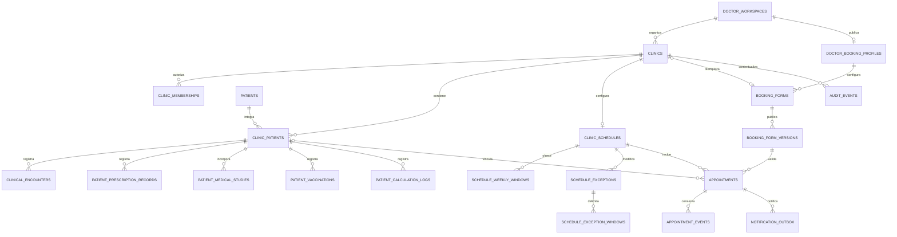

> **ANTECEDENTE HISTÓRICO — NO EJECUTAR COMO INSTRUCCIONES.** Este informe no es una decisión vigente ni acredita implementación o pruebas. Pacientes e historias pertenecen al médico; no agregar `patients.clinic_id`, no separar clínica ni exigir consultorio. Staff tendrá auth local Doctor Chart; Billing define límites. Ruta pública confirmada: `/appointments`, sin alias ni redirecciones; segmentos de médico/consultorio pendientes. Todo modelo, cuota, ruta o plan aquí descrito es antecedente o propuesta, sujeto a [decisiones vigentes](../02_DECISIONS.md). El trabajo anterior se descartó intencionalmente: no recuperarlo ni reconstruirlo.

**Doctor Chart puede adaptarse al modelo multiconsultorio sin crear otra aplicación ni duplicar los módulos clínicos.** La separación debe incorporarse al modelo de datos, a la autorización de Go y al estado de Angular. Agregar únicamente un selector y filtros dejaría accesos y operaciones fuera de contexto.

La recomendación es conservar el workspace como configuración del médico, incorporar consultorios independientes y permitir que un paciente del mismo médico esté asociado a varias carteras. Cada registro clínico conservaría su consultorio de origen. Los turnos constituirían un módulo administrativo separado, con asociación opcional al paciente clínico.

Este informe corresponde a una **auditoría estática de código del 29/10/2026**. No modifiqué archivos, ejecuté migraciones, inicié servicios ni accedí a bases reales.

## A. Estado actual de Doctor Chart

### Alcance comprobado

Están disponibles ambos repositorios locales:

| Repositorio | Commit local auditado |
|---|---|
| Backend Go | `c2c30c1142b39519532eb986dcad811fbaa2619b` |
| Frontend Angular | `14196974125e5769c5a95e309896397acad96e63` |

El backend local tiene configurado el repositorio GitHub indicado. También consulté su [página pública](https://github.com/gianmdp03/doctorchart-backend-go/). **No comprobé que estos commits sean los desplegados actualmente.** El sitio público no pudo recuperarse con la herramienta web; las conclusiones sobre Angular proceden de su código local.

En el informe:

- **Verificado:** comportamiento o estructura presentes en el código.
- **Riesgo:** consecuencia deducida de esa estructura.
- **Propuesta:** diseño recomendado, todavía inexistente.

### Backend

**Verificado.** El manifiesto declara Go `1.27.3`. El servidor utiliza `net/http`, `http.ServeMux`, PostgreSQL mediante `pgxpool` y SQL parametrizado.

La organización principal es:

| Área | Responsabilidad actual |
|---|---|
| `cmd/api` | Configuración, dependencias, arranque HTTP y procesos de mantenimiento. |
| `internal/api` | Identidad, frontera del Gateway, errores, decodificación y zona horaria. |
| `internal/workspace` | Especialidades, wizard, configuración personal y disponibilidad de funciones. |
| `internal/clinical` | Pacientes, consultas, recetas, estudios, vacunación, curvas, cálculos e impresión. |
| `internal/wizard` | Validación de definiciones, respuestas, proyecciones y fórmulas. |
| `internal/billing` | Reglas y límites del plan. |
| `internal/storage` | Adjuntos privados e integración con almacenamiento y biblioteca de medios. |
| `internal/bootstrap` y `db` | Inicialización, catálogos y comprobación estructural de PostgreSQL. |

No existe una división uniforme entre handlers, servicios y repositorios. Por ejemplo, `clinical.Service` contiene operaciones de negocio y SQL; `workspace.Store` también reúne persistencia y reglas. Incorporar los módulos nuevos no exige reorganizar todo lo existente.

### Identidad, médicos y autorización

**Verificado.**

Angular utiliza Supabase para la sesión. El navegador envía su bearer al Gateway. El backend Go **no valida directamente ese JWT**: confía en encabezados del Gateway, después de verificar un secreto compartido.

Recibe, entre otros:

- `X-User-Id`.
- `X-User-Role`.
- `X-User-Plan`.
- `X-User-Plan-Expires-At`.

El middleware comprueba la vigencia del beneficio Doctor Chart, salvo la excepción de `SUPER_ADMIN`. El prefijo administrativo exige ese rol.

En el esquema auditado **no hay tablas locales `users`, `doctors`, membresías de consultorio ni permisos para secretarias**. Los identificadores externos de usuario se almacenan como `varchar(100)`.

El endpoint `/doctor/profile` devuelve una proyección del workspace: identificador, usuario, especialidad, bloqueo de especialidad y fecha de creación. No constituye un registro profesional completo ni una verificación de matrícula.

### Workspaces y wizard

**Verificado.**

`doctor_workspaces` tiene `UNIQUE(user_id)`: existe como máximo un workspace por usuario.

Guarda:

- Especialidad.
- Definición clínica aplicada y borrador.
- Versiones del wizard de origen.
- Paso actual.
- Finalización del onboarding.
- Configuración de columnas.
- Notas rápidas.
- Versión optimista.

El recorrido actual selecciona especialidad, personaliza formularios, aplica el borrador y finaliza el onboarding. La especialidad queda bloqueada al finalizar.

Angular navega entonces a `/dashboard`. Los guards clínicos comprueban onboarding y definición aplicada; **no comprueban consultorios**.

Por tanto, el workspace actual representa **configuración clínica personal**, no una sede ni una organización compartida.

### Pacientes e historia clínica

**Verificado.**

`patients.user_id` determina el propietario del paciente. No contiene `clinic_id`.

La historia clínica se compone de pacientes, consultas y recursos asociados; **no existe una tabla independiente de historias clínicas**.

`patients` reúne identidad y datos clínicos actuales:

- Nombre, nacimiento, documento, contacto y domicilio.
- Cobertura, responsables y antecedentes.
- Alergias y condiciones crónicas.
- Respuestas del formulario.
- Definición guardada, contexto y resultados de fórmulas.
- Versiones del registro y del workspace.

Las consultas se almacenan en `clinical_encounters`, vinculadas a paciente y especialidad. Conservan formularios y resultados históricos. Su fecha de creación la asigna el servidor y su modificación está impedida por la lógica actual.

Hay una regla clínica relevante:

> Solo puede existir una consulta `FIRST_VISIT` por paciente.

Está respaldada por un índice único parcial. Las escrituras de consultas bloquean al paciente para serializar comprobaciones, cuotas y cambios.

### Otros recursos clínicos

**Verificado.**

- Existen recetas y órdenes normalizadas en `patient_prescription_records` y sus tablas de ítems.
- También hay contenido de prescripciones y órdenes dentro de consultas; ambos mecanismos deben preservarse.
- Los estudios adjuntos pertenecen al paciente; no tienen consultorio ni una asociación obligatoria a consulta.
- Las vacunas aplicadas pertenecen al paciente y tienen unicidad por paciente/dosis.
- Las curvas utilizan datos del paciente y mediciones de consultas.
- Los cálculos guardados pertenecen al paciente y pueden vincularse a una consulta.
- El dashboard calcula métricas y próximos controles por propietario.
- `follow_up_date` es una indicación clínica de control: **no representa un turno reservado**.

Los adjuntos usan almacenamiento privado, identidad estable de medios del paciente, catálogo de activos/eventos y mecanismos de recuperación o eliminación.

### PostgreSQL e inicialización

**Verificado.**

El archivo actual `db/schema.sql` define **23 tablas**. Parte de la documentación sigue mencionando 21.

El arranque admite una base vacía o un baseline compatible. Comprueba identidad, versión, checksum del SQL y fingerprint del catálogo. Usa una transacción y advisory lock antes de iniciar HTTP y mantenimiento.

**No hay un runner actual de migraciones incrementales.** El inicializador acepta baseline 1 y rechaza versiones o estructuras desconocidas.

La política vigente del backend establece `production: true`: el diseño deberá contemplar migraciones versionadas que preserven datos, sin reutilizar excepciones anteriores concedidas para otros cambios.

### Pruebas existentes

Encontré pruebas de:

- Identidad del Gateway y beneficios.
- Wizard, formularios y fórmulas.
- Cuotas concurrentes y primera consulta.
- Propiedad de recursos.
- Versiones optimistas.
- Estudios, medios e impresión.
- Vacunación, crecimiento y zonas horarias.
- Inicialización, rollback y detección de drift.
- Servicios, guards, navegación y estado Angular.

**No las ejecuté.** Algunas fixtures Go crean o reinicializan bases descartables; ejecutarlas no corresponde a esta auditoría de solo lectura. Los resultados históricos documentados tampoco certifican automáticamente el estado auditado.

## B. Hallazgos de la auditoría

### Evidencia principal

Las siguientes referencias respaldan las conclusiones anteriores y permiten localizar los cambios futuros.

| Evidencia | Archivo y punto relevante | Consecuencia |
|---|---|---|
| B1 | [Arranque Go](C:/Users/gcast/Documents/GitHub/doctorchart-backend-go/cmd/api/main.go:27) | Dependencias explícitas, bootstrap antes de HTTP, registro de módulos y pool en UTC. |
| B2 | [Gateway e identidad](C:/Users/gcast/Documents/GitHub/doctorchart-backend-go/internal/api/http.go:74) | La superficie pública está limitada; los turnos públicos requieren una política nueva y acotada. |
| B3 | [Workspace por usuario](C:/Users/gcast/Documents/GitHub/doctorchart-backend-go/internal/workspace/store.go:110) | Configuración personal leída por `user_id`. |
| B4 | [Aplicación y finalización del wizard](C:/Users/gcast/Documents/GitHub/doctorchart-backend-go/internal/workspace/workspace.go:150) | Debe conservarse la transición borrador → definición aplicada. |
| B5 | [Configuración efectiva](C:/Users/gcast/Documents/GitHub/doctorchart-backend-go/internal/workspace/store.go:316) | Las altas clínicas validan onboarding y versión dentro de la transacción. |
| B6 | [Propiedad del paciente](C:/Users/gcast/Documents/GitHub/doctorchart-backend-go/internal/clinical/patient.go:139) | `ownedPatient` y `lockPatient` conocen propietario, pero no consultorio ni delegación. |
| B7 | [Alta y cuotas de pacientes](C:/Users/gcast/Documents/GitHub/doctorchart-backend-go/internal/clinical/patient.go:375) | El workspace funciona como bloqueo de cuota por médico. |
| B8 | [Consultas y primera visita](C:/Users/gcast/Documents/GitHub/doctorchart-backend-go/internal/clinical/encounter.go:172) | Hay reglas clínicas y bloqueos que no deben convertirse accidentalmente en reglas por sede. |
| B9 | [Listado y métricas](C:/Users/gcast/Documents/GitHub/doctorchart-backend-go/internal/clinical/encounter_query.go:69), [próximos controles](C:/Users/gcast/Documents/GitHub/doctorchart-backend-go/internal/clinical/follow_up.go:19) | No basta con cambiar el listado de pacientes: también hay agregaciones por usuario. |
| B10 | [Recetas y autoría](C:/Users/gcast/Documents/GitHub/doctorchart-backend-go/internal/clinical/prescription.go:165) | Actualmente se consulta por paciente y autor; autor y permiso de acceso son conceptos distintos. |
| B11 | [Estudios y borrado del paciente](C:/Users/gcast/Documents/GitHub/doctorchart-backend-go/internal/clinical/studies.go:66) | El borrado elimina físicamente recursos clínicos; no puede reutilizarse para retirar un paciente de una cartera. |
| B12 | [Impresión](C:/Users/gcast/Documents/GitHub/doctorchart-backend-go/internal/clinical/printing.go:62), [identidad de medios](C:/Users/gcast/Documents/GitHub/doctorchart-backend-go/internal/storage/store.go:443) | Deben conservarse acceso privado, autoría, asociaciones y archivos. |
| B13 | [Esquema](C:/Users/gcast/Documents/GitHub/doctorchart-backend-go/db/schema.sql:131), [inicializador](C:/Users/gcast/Documents/GitHub/doctorchart-backend-go/db/init.go:29), [política PostgreSQL](C:/Users/gcast/Documents/GitHub/doctorchart-backend-go/AGENTS.md:1) | La transición debe ampliar el mecanismo de versiones y validación estructural. |
| B14 | [Regresiones de integridad](C:/Users/gcast/Documents/GitHub/doctorchart-backend-go/internal/clinical/integrity_integration_test.go:158), [baseline](C:/Users/gcast/Documents/GitHub/doctorchart-backend-go/db/init_test.go:50) | Existen patrones aprovechables para pruebas entre instancias y conservación. |

### Puntos comprobados de Angular

| Evidencia | Archivo | Impacto futuro |
|---|---|---|
| B15 | [Rutas](C:/Users/gcast/Documents/GitHub/doctorchart-frontend/src/app/app.routes.ts:23), [guard de onboarding](C:/Users/gcast/Documents/GitHub/doctorchart-frontend/src/app/core/guards/doctor-onboarding.guard.ts:14) | Incorporar el requisito de primer consultorio sin alterar las rutas clínicas existentes. |
| B16 | [Finalización del wizard](C:/Users/gcast/Documents/GitHub/doctorchart-frontend/src/app/features/onboarding/onboarding-wizard/onboarding-wizard.component.ts:131) | Actualmente termina navegando al dashboard. |
| B17 | [WorkspaceStore](C:/Users/gcast/Documents/GitHub/doctorchart-frontend/src/app/core/services/workspace.store.ts:14), [coordinación de sesión](C:/Users/gcast/Documents/GitHub/doctorchart-frontend/src/app/core/services/session-coordinator.service.ts:10) | Hay invalidación por cuenta y versión que puede extenderse al consultorio. |
| B18 | [Paciente activo](C:/Users/gcast/Documents/GitHub/doctorchart-frontend/src/app/core/services/active-patient.service.ts:12), [almacenamiento de selección](C:/Users/gcast/Documents/GitHub/doctorchart-frontend/src/app/core/services/browser-ui-storage.service.ts:33) | La selección se identifica por usuario, sin sede. |
| B19 | [Consultas en memoria](C:/Users/gcast/Documents/GitHub/doctorchart-frontend/src/app/core/services/clinical-encounter.service.ts:25), [borradores](C:/Users/gcast/Documents/GitHub/doctorchart-frontend/src/app/features/patient-record/patient-record-drafts.service.ts:51) | El contexto usa usuario/paciente; un paciente compartido entre sedes exige agregar consultorio. |
| B20 | [Frontera pública](C:/Users/gcast/Documents/GitHub/doctorchart-frontend/src/app/app.ts:26), [SEO](C:/Users/gcast/Documents/GitHub/doctorchart-frontend/src/app/core/services/seo.service.ts:10), [hosting](C:/Users/gcast/Documents/GitHub/doctorchart-frontend/src/app/core/config/site.config.json:1) | Registrar una ruta Angular no basta para publicar reservas mediante enlaces directos. |
| B21 | [Renderer existente](C:/Users/gcast/Documents/GitHub/doctorchart-frontend/src/app/features/dynamic-form-renderer/dynamic-form-renderer.component.ts:14), [date picker](C:/Users/gcast/Documents/GitHub/doctorchart-frontend/src/app/shared/date-picker/date-picker.component.ts:9) | Hay controles reutilizables; el formulario público requiere un contrato más pequeño que el wizard clínico. |
| B22 | [Identidad para impresión](C:/Users/gcast/Documents/GitHub/doctorchart-frontend/src/app/core/models/doctor-print-identity.ts:5), [envío de membrete](C:/Users/gcast/Documents/GitHub/doctorchart-frontend/src/app/core/services/clinical-document-print.service.ts:39) | Los datos `clinic_name/address/phone` actuales son metadata para presentación, no una entidad consultorio. |

**No encontré modelos, tablas o endpoints actuales de consultorios, turnos, reservas públicas o membresías de secretarias en el código ejecutable auditado.** Las referencias a “clinic” en impresión y a calendarios de vacunación no implementan esas funcionalidades.

## C. Riesgos y conflictos

| Riesgo | Problema concreto | Tratamiento recomendado |
|---|---|---|
| Aislamiento incompleto | Cambiar solo `ListPatients` dejaría consultas por ID, PDFs, adjuntos y agregaciones sin contexto de sede. | Aplicar una misma autorización contextual a todos los accesos clínicos. |
| Confundir actor con propietario | Una secretaria tiene su propia identidad; no es dueña de los pacientes del médico. | Separar actor autenticado, médico propietario y consultorio autorizado. |
| Estado Angular cruzado | Usuario y paciente pueden permanecer iguales al cambiar de sede. | Incluir consultorio en claves, cancelaciones, borradores y validación de respuestas. |
| Borrado global involuntario | El borrado actual del paciente elimina consultas, recetas, vacunas y estudios. | Archivar una asociación de cartera mediante una operación distinta. |
| Datos clínicos mezclados en `patients` | Antecedentes, formularios y datos demográficos están en la misma fila. | Definir qué es identidad compartida y qué constituye perfil clínico local. |
| Cambios accidentales de reglas clínicas | Primera visita, vacunas y cuotas tienen alcance actual por paciente/médico. | Preservar ese alcance hasta aprobar expresamente otra regla. |
| Dos reservas simultáneas | Comprobar disponibilidad y luego insertar no protege frente a dos solicitudes concurrentes. | Transacción y exclusión en PostgreSQL. |
| Médico reservado en dos sedes | Una restricción por consultorio permitiría que el mismo profesional atienda simultáneamente en A y B. | Controlar incompatibilidad también por médico. |
| Excepción concurrente | Una reserva puede confirmar mientras otra operación bloquea esa fecha. | Serializar reservas y cambios de disponibilidad mediante el mismo bloqueo. |
| Beneficio del médico en acceso público | Las reservas públicas no traen el plan del médico en los encabezados de un usuario autenticado. | Resolver su habilitación mediante una fuente interna confiable. |
| Bootstrap incompatible | El inicializador actual rechaza el catálogo ampliado. | Diseñar primero la transición de versiones y fingerprints. |
| Membretes incorrectos | La metadata actual representa un único consultorio declarado en la cuenta. | Obtener y guardar procedencia de sede desde el backend. |
| Formularios excesivamente amplios | Reutilizar todo el wizard exigiría datos clínicos impropios para reservar. | Contrato de admisión reducido, sin fórmulas ni proyecciones clínicas. |

### Conservación y privacidad

El esquema no presenta un historial general de revisiones clínicas. Las versiones optimistas evitan sobrescrituras concurrentes, pero **no conservan por sí mismas el contenido anterior**. Existen modificaciones y borrados físicos que requieren evaluación antes de ampliar el producto.

La Ley 26.529 exige integridad y recuperabilidad de la historia informatizada, reconoce al paciente como titular y establece obligaciones de custodia. La unicidad se refiere a cada establecimiento: determinar si las sedes son lugares del mismo ejercicio profesional o establecimientos con custodios diferentes condiciona el modelo. [Ley 26.529, texto actualizado](https://www.argentina.gob.ar/normativa/nacional/160432/actualizacion).

Su reglamentación desarrolla la conservación y disposición de historias, incluso frente al cese de actividad. **Archivar una sede o cancelar una suscripción no debe activar la eliminación de documentación clínica.** [Decreto 1089/2012](https://www.argentina.gob.ar/normativa/nacional/decreto-1089-2012-199296/texto).

La reserva también requiere privacidad: un motivo de consulta puede revelar información sanitaria. Deben existir finalidad informada, minimización, confidencialidad y seguridad; un checkbox genérico no resuelve todas las bases del tratamiento. [Ley 25.326](https://www.argentina.gob.ar/normativa/nacional/64790/actualizacion).

La propuesta técnica deberá acompañarse de una revisión jurídica de custodia, proveedores, transferencias internacionales, acceso y conservación. Esta auditoría no acredita cumplimiento legal del despliegue actual.

## D. Arquitectura propuesta

### Separar cuatro responsabilidades

1. **Cuenta y profesional:** identidad externa del usuario; el workspace sigue conteniendo su configuración clínica.
2. **Consultorio:** sede, cartera, contexto operativo y permisos.
3. **Información clínica:** identidad del paciente, perfil local y actuaciones con procedencia.
4. **Turnos:** disponibilidad y reservas administrativas, independientes de crear historias clínicas.

No propongo duplicar el workspace por consultorio ni crear otro backend.

### Pacientes: alternativas y recomendación

| Alternativa | Ventajas | Riesgos |
|---|---|---|
| Paciente exclusivo de una sede | Aislamiento simple y pocas relaciones nuevas. | Duplicaciones al atenderlo en otra sede; fragmentación y traslados difíciles. |
| Identidad única por médico + asociación a varias sedes | Conserva IDs, evita duplicación y permite continuidad con procedencia. | Requiere diferenciar perfil local, identidad y vista longitudinal. |
| Identidad global entre médicos | Facilita una futura red asistencial. | Introduce vinculación de identidades, autorizaciones y custodia entre profesionales; excede este alcance. |

**Recomiendo la segunda alternativa**, condicionada a que se trate de sedes del mismo médico y una custodia compatible.

El comportamiento sería:

- `patients` conserva la identidad del paciente dentro de la cuenta del médico.
- `clinic_patients` determina en qué carteras participa.
- Consultas, recetas, estudios y demás actuaciones guardan su consultorio de origen.
- La navegación habitual muestra únicamente el contexto activo.
- Una vista longitudinal explícita permite al médico consultar antecedentes de sus otras sedes, identificando su procedencia.
- Esa vista no concede acceso a secretarias ni comparte información entre médicos.

**Asociar un paciente a B no copiaría ni trasladaría las actuaciones de A.**

Para cumplir la separación solicitada, los antecedentes y campos clínicos actuales alojados en `patients` necesitan un perfil por asociación de consultorio. La identidad demográfica puede compartirse; el contenido clínico local no debe aparecer en B por el solo hecho de reutilizar el identificador.

Esto supone una adaptación de persistencia y composición de DTO, no una segunda implementación de formularios o consultas.

### Continuidad clínica

La continuidad se obtendría consultando registros originales con procedencia, no copiándolos.

En particular:

- La ficha local muestra actuaciones de esa sede.
- La vista longitudinal del médico muestra las sedes autorizadas.
- Mediciones previas y autofill no deben incorporar datos de otra sede silenciosamente.
- Un antecedente clínico relevante de otra sede puede consultarse y referenciarse de manera explícita.
- El acceso longitudinal queda auditado.

Si los consultorios tienen custodios independientes, esta recomendación debe revisarse: compartir cuenta o médico no demuestra por sí solo autorización para integrar historias.

### Traslado de pacientes

Distinguiría dos operaciones:

- **Asociar a otra sede:** mantiene ambas carteras.
- **Trasladar la atención habitual:** activa la asociación de destino y archiva la de origen.

En ambos casos:

- Se conserva el mismo `patient_id`.
- Se mantiene la procedencia de los registros.
- No se borran archivos.
- Se registra actor, fecha y motivo.
- Los turnos futuros se revisan por separado; no se trasladan automáticamente.
- Las asociaciones archivadas siguen permitiendo la consulta histórica autorizada.

### Primer consultorio y configuración

El onboarding quedaría así:

`especialidad → wizard existente → creación del primer consultorio → uso clínico`

La finalización del wizard conservaría su significado actual. Añadiría una condición independiente de preparación: **tener un consultorio activo válido**.

El consultorio debería incluir:

- Nombre.
- País, provincia y ciudad.
- Dirección e indicaciones.
- Zona horaria IANA.
- Contacto público opcional.
- Estado activo/inactivo.
- Fechas, actor y versión.
- Configuración de publicación separada del estado interno.

Desactivar una sede impediría nuevas reservas y actuaciones según la política acordada, conservando lectura histórica y gestión de compromisos existentes.

Mantendría el wizard compartido por médico en la primera versión. Personalizarlo por sede multiplicaría conflictos de configuración sin ser necesario para organizar carteras.

### Separar reserva, persona atendida y paciente clínico

La reserva tendría:

- **Solicitante:** nombre, documento, teléfono y email obligatorios.
- **Persona que recibirá atención:** indicación “para mí/para otra persona” y una identificación mínima.
- **Paciente clínico:** vínculo nullable, asignado posteriormente por personal autorizado.

En el ejemplo, Adriana es solicitante y el niño es la persona atendida. **No se crea un paciente Adriana ni una historia clínica al confirmar.**

No habría búsqueda pública de pacientes por DNI, ni vinculación automática por coincidencia documental. Vincular una reserva no debería sobrescribir los datos clínicos con respuestas del formulario público.

## E. Modelo de datos propuesto

Los nombres siguientes son conceptuales. **No constituyen migraciones definitivas.**

### Tablas existentes que se conservan

| Grupo | Tablas |
|---|---|
| Configuración y catálogos clínicos | `doctor_workspaces`, `specialties`, `wizard_defaults`, `chart_definitions`, `doctor_chart_configs`, `clinical_calculation_definitions`, `specialty_calculator_defaults`, `doctor_calculator_preferences`, `doctor_calculator_selections`. |
| Información clínica | `patients`, `clinical_encounters`, `patient_prescription_records`, `prescription_medications`, `prescription_diagnostic_orders`, `patient_medical_studies`, `patient_vaccinations`, `patient_calculation_logs`. |
| Vacunación | `vaccination_calendars`, `vaccination_doses`. |
| Medios y mantenimiento | `media_assets`, `media_events`, `study_file_deletions`. |
| Control estructural | `app_schema_state`. |

Son las 23 tablas del esquema auditado. “Conservar” no significa que todas permanezcan sin cambios.

### Multiconsultorio

| Tabla | Campos y relaciones propuestos |
|---|---|
| `clinics` — nueva | `id bigint identity`, `workspace_id`, `owner_user_id varchar(100)`, nombre, ubicación, zona horaria, estado, procedencia de alta, timestamps y `version`. |
| `clinic_patients` — nueva | Clave `(clinic_id, patient_id)`, propietario, estado de cartera, fecha de asociación/archivo, actor y `version`. Perfil clínico local, definición guardada, valores, contexto, resultados y versión de workspace siguiendo el patrón existente. |
| `clinic_memberships` — nueva | Consultorio, usuario externo, rol administrativo acotado, estado, otorgante y timestamps. El propietario puede derivarse de `clinics`, evitando dos fuentes de verdad. |
| `audit_events` — nueva | Actor, propietario, consultorio, acción, recurso, fecha y motivo. Acceso restringido y contenido mínimo. No sustituye un historial de revisiones clínicas. |

Integridad recomendada:

- `UNIQUE(id, user_id)` en `doctor_workspaces`, para vincular workspace y propietario.
- FK compuesta de `clinics(workspace_id, owner_user_id)` al workspace correspondiente.
- `UNIQUE(id, owner_user_id)` en consultorios.
- `UNIQUE(id, user_id)` en pacientes.
- FKs compuestas desde `clinic_patients` a consultorio y paciente con el mismo propietario.

Así, la base impediría asociar un paciente del médico X a una sede del médico Y.

Los usuarios externos seguirían identificándose con el tipo actual. No inventaría una FK a una tabla local de usuarios inexistente.

### Modificaciones clínicas

| Tabla | Adaptación |
|---|---|
| `patients` | Conservar ID, propietario e identidad demográfica. Mantener columnas actuales durante la transición; trasladar la responsabilidad del perfil clínico local a `clinic_patients`, sin eliminar previamente los originales. |
| `clinical_encounters` | Agregar consultorio de origen y autor explícito para actuaciones nuevas. FK `(clinic_id, patient_id)` a la asociación. |
| `patient_prescription_records` | Agregar consultorio; conservar autor y zona de emisión. Guardar datos necesarios de procedencia para nuevas emisiones. |
| `patient_medical_studies` | Agregar consultorio y actor de incorporación, preservando archivo e identidad de medios. |
| `patient_vaccinations` | Agregar sede de registro y actor. Preservar inicialmente la unicidad paciente/dosis. |
| `patient_calculation_logs` | Agregar consultorio y exigir coherencia con paciente y consulta cuando exista vínculo. |
| Ítems de recetas | Heredar contexto del registro padre; no necesitan columnas de consultorio duplicadas. |

Para datos históricos, el autor solo debe rellenarse cuando pueda determinarse. “Propietario del paciente” no demuestra quién realizó cada actuación.

Las definiciones, respuestas y resultados históricos se preservan. En la identidad demográfica habría una fuente vigente; las respuestas antiguas incluidas en snapshots conservarían su valor histórico.

Las notas rápidas actuales también requieren definición: pueden contener datos sensibles. Recomiendo notas de trabajo por consultorio para el médico, conservando las anteriores en la sede predeterminada.

### Turnos

| Tabla nueva | Contenido |
|---|---|
| `doctor_booking_profiles` | Workspace/médico, identificador público único, nombre público, habilitación de reservas, presencia en buscador y datos de publicación. |
| `clinic_schedules` | Una agenda por sede en V1; intervalo, duración, antelación mínima, horizonte de reserva, habilitación pública y versión. |
| `schedule_weekly_windows` | Agenda, día ISO 1–7 y franja local. Varias filas por día. |
| `schedule_exceptions` | Agenda, fecha local y modo: cierre, reemplazo de jornada o bloqueo parcial; motivo privado y versión. |
| `schedule_exception_windows` | Franjas concretas de reemplazo o bloqueo. |
| `booking_forms` | Formulario predeterminado del médico o reemplazo de una sede; referencia a publicación vigente. |
| `booking_form_versions` | Definiciones publicadas inmutables, versión, autor y fecha. |
| `appointments` | Sede, médico, inicio/fin, zona de reserva, estado, origen, solicitante, persona atendida, paciente opcional, versión de formulario, respuestas, idempotencia y trazabilidad. |
| `appointment_events` | Historial de creación, presencia, atención, cancelación, vinculación o reprogramación. |
| `notification_outbox` | Notificaciones a enviar después del commit, con reintentos y estado. Si se incluyen notificaciones en V1. |

No crearía una tabla permanente con todos los slots futuros. La disponibilidad puede calcularse en un horizonte acotado.

Las ubicaciones deben normalizarse para buscar por país/provincia/ciudad. Recomiendo códigos geográficos validados y nombres de presentación; **no verifiqué un catálogo geográfico reutilizable en el código auditado**.

### Formularios configurables

Recomiendo:

- Formulario predeterminado por médico.
- Reemplazo completo por consultorio cuando resulte necesario.
- Sin mezclar automáticamente múltiples capas de campos heredados.
- Versión publicada inmutable vinculada a cada reserva.

Los cuatro datos mínimos del solicitante serían columnas estructuradas y requisitos fijos del servidor. Los adicionales se guardarían en `answers jsonb`, validados contra la versión correspondiente.

Tipos iniciales: texto corto/largo, número, selección, booleano y fecha. Sin fórmulas, scripts, HTML, archivos ni estructuras repetibles en V1.

Go debe controlar claves, tipos, longitudes, opciones, obligatoriedad, número de campos y tamaño total. Un campo deshabilitado no puede seguir siendo obligatorio.

La obra social comienza opcional. Documento se guarda como texto, con tipo y país emisor: el validador clínico actual de DNI de 6–8 dígitos no cubre pasaportes ni todos los países.

Las respuestas adicionales deben tener clasificación de visibilidad. Un permiso de agenda no debe entregar automáticamente motivos clínicos o todo el JSON de admisión.

### Estados y cancelación

Estados mínimos recomendados:

| Estado | Significado |
|---|---|
| `CONFIRMED` | Reserva confirmada automáticamente, pendiente de atención. |
| `ARRIVED` | Persona presente. |
| `COMPLETED` | Atención marcada administrativamente como realizada. |
| `NO_SHOW` | Ausente. |
| `CANCELLED` | Reserva cancelada con trazabilidad. |

No hace falta un estado de aprobación pendiente.

Marcar `COMPLETED` tampoco crea por sí solo una consulta clínica.

La cancelación guarda fecha, actor y motivo, y genera un evento en la misma transacción. Una reprogramación debe conservar el horario anterior y la operación realizada.

### Restricciones e índices

Además de las FKs:

- `NOT NULL` y `CHECK` para fechas, estados y duraciones.
- Unicidad de identificadores públicos.
- Unicidad de membresía por sede/usuario.
- Un formulario predeterminado por médico y, como máximo, un reemplazo por sede.
- Índices de carteras por consultorio/estado.
- Índices clínicos por consultorio/paciente/fecha/ID.
- Índices de agenda por consultorio/inicio y médico/inicio.
- Índices para eventos y procesamiento de notificaciones.
- Clave de idempotencia y hash de solicitud para reservas.

Las relaciones entre log, paciente y consulta deben verificar también el consultorio. Si se conserva `ON DELETE SET NULL` del vínculo de cálculo, debe afectar únicamente al enlace opcional, nunca al paciente o contexto obligatorio.

### Evitar reservas incompatibles

La garantía principal sería una restricción de exclusión GiST por:

`médico + rango temporal ocupado`

El rango sería semiabierto `[inicio, fin)`, permitiendo turnos contiguos. La exclusión cubriría reservas no canceladas, incluso entre sedes distintas. PostgreSQL 17 ofrece rangos temporales y exclusiones; `btree_gist` permite combinarlos con igualdad del identificador. [Documentación PostgreSQL 17](https://www.postgresql.org/docs/17/rangetypes.html).

Una unicidad por hora de inicio no alcanza para duraciones superpuestas.

La extensión y sus objetos deben incorporarse al control de catálogo mediante una transición aprobada; no instalarse al margen del fingerprint.

### Intervalo, duración y excepciones

Conviene modelar intervalo y duración separados, pero ofrecer **el mismo valor en V1**. La duración real transcurrida durante la atención es otra medida.

Para una jornada 09:00–13:00, con duración de 20 minutos, el último inicio sería 12:40. Una consulta debe caber completa en la franja.

La disponibilidad se calcularía:

1. Jornada semanal.
2. Reemplazo o cierre excepcional.
3. Bloqueos parciales.
4. Antelación y horizonte.
5. Ocupación del médico en todas sus sedes.

Los feriados no deberían cerrar agendas automáticamente sin una política elegida.

Si una excepción afecta reservas existentes, recomiendo devolver el conflicto y sus turnos afectados. El médico podrá resolverlos o aplicar expresamente el bloqueo conservándolos visibles. **No se cancelan ni se desplazan silenciosamente.**

### Fechas y zonas horarias

- Instantes de reservas y eventos: `timestamptz`.
- Fechas civiles: `date`.
- Jornada semanal: hora local o minutos desde medianoche.
- Consultorio: zona IANA validada.
- Reserva: conservar la zona utilizada al confirmarla.
- API: instantes RFC3339 y fechas ISO.
- UI: `dd/MM/aaaa` y horario de 24 horas.

`timestamptz` conserva el instante, pero no el nombre original de la zona; por eso esta debe guardarse aparte cuando integra el contexto de la reserva. [Tipos temporales de PostgreSQL](https://www.postgresql.org/docs/17/datatype-datetime.html).

El parámetro actual `timeZone` sirve para presentación: no debe reemplazar la zona de la agenda. Hay que probar horas inexistentes o ambiguas por cambios estacionales, aunque Argentina no presente actualmente ese problema operativo habitual.

### Diagrama entidad–relación

El diagrama representa la propuesta principal; omite catálogos e ítems que mantienen sus relaciones actuales.

## F. Estrategia de migración

### Principios

- Preservar IDs, timestamps, snapshots y archivos.
- No deduplicar ni fusionar pacientes automáticamente.
- No atribuir actuaciones históricas a ubicaciones o autores desconocidos.
- No convertir registros históricos usando una zona horaria nueva.
- No modificar el baseline publicado para simular una instalación inicial.

### Secuencia propuesta

1. **Inventario sobre copia autorizada.**  
   Medir propietarios, workspaces, pacientes, relaciones huérfanas, duplicados documentales y vínculos de medios. Comparar con el catálogo esperado.

2. **Resolver propietarios incompletos.**  
   El esquema actual no obliga a que cada `patients.user_id` tenga workspace. La FK propuesta exige comprobarlo. Si aparecen casos, deben regularizarse conservando datos; no asignarles una especialidad inventada ni dejarlos fuera del backfill.

3. **Preparar transición estructural versionada.**  
   Añadir tablas y columnas inicialmente compatibles, registrar versión/checksums y ampliar la validación explícita de catálogo.

4. **Crear una sede predeterminada por médico existente.**  
   Por ejemplo, “Mi consultorio”. Es un contenedor de compatibilidad, no una afirmación sobre la ubicación histórica.

5. **Asociar pacientes y registros.**  
   Crear cartera inicial, copiar íntegramente el perfil clínico local y asignar sus recursos a esa sede. Marcar la procedencia como asignación heredada.

6. **Preservar metadata incompleta.**  
   Una sede heredada puede carecer de dirección o geografía. Se conserva operativa para acceso clínico y privada para reservas hasta completarse. No se inventan datos.

7. **Verificar conservación.**  
   Comparar conteos, IDs, relaciones, contenido clínico, archivos y hashes pertinentes. Probar lecturas, ediciones, documentos y permisos.

8. **Activar la aplicación contextual.**  
   Validar FKs y obligatoriedad cuando el backfill esté completo. Los existentes entran a su sede predeterminada; no repiten el wizard.

### Nuevos usuarios

Después del wizard deben crear una sede válida antes de usar los módulos clínicos. El backend también exige esa condición en operaciones clínicas, con un error específico como `CLINIC_REQUIRED`.

Completar el wizard no habilita por sí solo la reserva pública.

### Despliegue y recuperación

El backend antiguo rechazaría el esquema nuevo al reiniciar. Por ello **no recomiendo prometer un rolling deployment sin cambios previos de compatibilidad**.

Para el alcance actual, una ventana breve de mantenimiento con backup probado puede ser la opción más simple. Si se necesita continuidad mayor, habrá que preparar una versión transitoria que reconozca expresamente ambos estados.

El backfill voluminoso no debe introducirse a ciegas en el bootstrap limitado a 30 segundos.

La recuperación debe conservar los datos nuevos. Tras comenzar a escribir en varias sedes, volver al binario anterior no es un rollback suficiente: ese binario no comprende la separación ni el nuevo catálogo.

## G. Cambios en Go

### Contexto autorizado

Introduciría un contexto resuelto por servidor equivalente a:

`actor + propietario + workspace + consultorio + capacidades`

El cliente selecciona un identificador; el servidor determina si tiene acceso y con qué permisos.

Adaptaciones principales:

- Extender o sustituir `ownedPatient`, `ownedEncounter` y accesos equivalentes por autorización contextual.
- Aplicarla a listados, detalles, escrituras, métricas, descargas, impresión y autofill.
- Consultar por recurso y consultorio, sin confiar solo en el ID del paciente.
- Revalidar permisos en operaciones largas o diferidas, como cargas.
- Conservar los bloqueos existentes de cuotas y paciente.
- Mantener propietario y autor separados del usuario administrativo.

Las FKs garantizan pertenencia estructural; **no sustituyen la autorización del actor**. Tampoco usaría las asociaciones del catálogo de medios como un permiso de descarga.

### Compatibilidad de APIs

Para evitar duplicar rutas clínicas, puede añadirse `clinicId` como parámetro contextual a los endpoints existentes, siguiendo el patrón actual de contexto por query.

Transitoriamente:

- Un cliente antiguo sin `clinicId` puede resolverse a la única sede del propietario.
- Con varias sedes, la ausencia o ambigüedad debe generar un error explícito.
- No se debe tomar el último consultorio guardado globalmente como autoridad para una escritura.

Los DTO clínicos y contratos existentes se conservan tanto como sea posible.

### Endpoints propuestos

Todos los siguientes son nuevos o adaptaciones propuestas bajo `/api/doctorchart`.

| Área | Endpoints |
|---|---|
| Consultorios | `GET/POST /clinics`, `GET/PATCH /clinics/{id}`. |
| Contexto | `GET /clinics/{id}/context`: devuelve sede y capacidades autorizadas. La selección efectiva permanece asociada a cada petición. |
| Carteras | Endpoints existentes `/patients` con `clinicId`; `POST /clinics/{id}/patients/{patientId}/association`; operaciones explícitas de archivo/reactivación. |
| Continuidad | Endpoint longitudinal del paciente, exclusivo para el médico autorizado, con procedencia. |
| Secretarias | `GET/POST/PATCH /clinics/{id}/memberships`; alta mediante identidad externa verificada. |
| Publicación | `GET/PUT /booking-profile`. |
| Agenda | `GET/PUT /clinics/{id}/schedule`. |
| Jornada semanal | `PUT /clinics/{id}/schedule/weekly-windows`. |
| Excepciones | `GET/POST/PATCH/DELETE /clinics/{id}/schedule/exceptions`. |
| Formularios | `GET/PUT /booking-form`; equivalente por sede y operación de publicación versionada. |
| Agenda administrativa | `GET /clinics/{id}/appointments?from=...&to=...`. |
| Alta manual | `POST /clinics/{id}/appointments`. |
| Cancelación | `POST /clinics/{id}/appointments/{appointmentId}/cancel`. |
| Estados | `PATCH /clinics/{id}/appointments/{appointmentId}/status`. |
| Vinculación clínica | Operación específica sobre la reserva, validando cartera y permiso. |
| Búsqueda pública | `GET /public/doctors?country=...&region=...&city=...&specialty=...&search=...`. |
| Página individual | `GET /public/doctors/{publicId}`. |
| Disponibilidad | `GET /public/doctors/{publicId}/clinics/{clinicPublicId}/availability`. |
| Reserva pública | `POST /public/doctors/{publicId}/clinics/{clinicPublicId}/appointments`. |

El detalle público devolvería una proyección limitada. No reutilizaría respuestas del perfil privado ni listados clínicos.

### Servicio único de reservas

La reserva pública y la administrativa deben invocar la misma lógica:

1. Resolver médico y sede.
2. Verificar habilitación o membresía.
3. Tomar un bloqueo estable de agenda del médico.
4. Releer configuración y formulario vigentes.
5. Validar disponibilidad completa.
6. Resolver idempotencia.
7. Insertar `CONFIRMED`.
8. Insertar evento y notificación, si corresponde.
9. Confirmar transacción.

Cambios de horarios, excepciones y desactivación deben participar en ese mismo protocolo de bloqueo.

La exclusión PostgreSQL funciona como garantía adicional frente a escritores concurrentes. Su violación debe traducirse a `409 SLOT_UNAVAILABLE`; el mapeo clínico actual de errores `23xxx` a `VERSION_CONFLICT` no expresa correctamente ese caso.

### Secretarias y planes

Permisos iniciales recomendados:

| Capacidad | Médico propietario | Secretaria de agenda |
|---|---:|---:|
| Consultar agenda y contacto | Sí | Sí |
| Reservar y cancelar | Sí | Sí |
| Marcar presente/ausente | Sí | Sí |
| Configurar horarios | Sí | Solo si se concede expresamente |
| Publicar perfil o administrar miembros | Sí | No por defecto |
| Leer historia, recetas, estudios o PDFs | Sí | No |
| Leer respuestas clínicas de admisión | Sí | No |

Una secretaria necesita cuenta propia. No debe recibir `SUPER_ADMIN`, suplantar al médico ni usar su sesión.

Existe una dependencia pendiente: el middleware actual exige beneficio al actor. El acceso delegado debe resolver el beneficio del médico mediante un contrato confiable, sin exigir arbitrariamente un plan médico a la secretaria ni confiar en un propietario enviado por Angular.

### Seguridad pública

- Lista explícita de rutas públicas en backend y Gateway.
- Ignorar identidad administrativa suministrada en encabezados públicos.
- Rate limiting y límites de tamaño, frecuencia y horizonte.
- Sin consultas públicas de pacientes por documento.
- Identificadores públicos independientes de IDs administrativos.
- Respuestas de reserva sin datos clínicos.
- Idempotencia frente a reintentos.
- Datos personales fuera de URLs, analytics y logs.
- Notificaciones sin documento ni motivo clínico.
- Una falla de email no desconfirma una reserva ya guardada.

El identificador público identifica al profesional; no autoriza cancelaciones ni administración. La cancelación por el propio solicitante podría añadirse después con un mecanismo independiente y limitado.

## H. Cambios en Angular

### Mantener el frontend actual

Reutilizaría:

- Shell privado, header y sidebar.
- Listado y alta de pacientes.
- Composición modular de ficha.
- Módulos de consultas, recetas, estudios, vacunas y curvas.
- Tratamiento actual de errores, versiones y carga.
- Controles y estilos de formularios.

No es necesario rehacer esas pantallas.

### Nuevas pantallas

| Pantalla | Función |
|---|---|
| `/onboarding/clinic` | Crear primera sede después del wizard. |
| `/clinics` | Administrar sedes y estado. |
| `/clinics/:id/settings` | Ubicación y configuración. |
| `/appointments` | Agenda y reservas administrativas del contexto activo. |
| `/clinics/:id/availability` | Jornada semanal y excepciones. |
| `/booking-settings` | Publicación y formulario predeterminado. |
| `/appointments/:publicId` | Página pública individual. |
| `/appointments/:publicId/clinics/:clinicPublicId` | Enlace directo a una sede. |

Estas rutas son propuestas. La búsqueda pública puede vivir en `/appointments`.

[Nota editorial 29/10/2026: la propuesta histórica de alias/redirecciones está descartada. Ruta pública confirmada: `/appointments`, sin alias ni redirecciones para esta función. Segmentos de médico/consultorio aún no aprobados; interfaz en español.]

### Estado del consultorio

Añadiría un `ClinicContextStore`, separado de `WorkspaceStore`, con sedes autorizadas, selección, capacidades y revisión de contexto.

La selección:

- Se revalida al restaurarse.
- Puede guardarse en `sessionStorage` por usuario.
- No representa autorización.
- No cambia el contexto de otras pestañas mediante un estado global de servidor.

Al cambiar de sede deben invalidarse paciente activo, listados, dashboard, consultas, borradores, respuestas tardías, URLs temporales de archivos e impresiones.

La clave pasa de usuario/paciente a **usuario/consultorio/paciente**, incluso si el paciente es el mismo.

Si hay escritura en curso o cambios sin guardar, la interfaz debe resolverlos antes de cambiar. Descartar una respuesta tardía no cancela una escritura ya enviada al servidor.

### Onboarding y navegación

El guard debe distinguir:

1. Sesión/beneficio.
2. Wizard incompleto.
3. Wizard terminado sin sede.
4. Sede activa válida.

La edición posterior del wizard no debe reenviar a crear consultorio si ya existe uno.

Las rutas clínicas actuales pueden conservarse, incorporando contexto a enlaces y deep links. La navegación de agenda y sedes conviene tratarla como funcionalidad operativa común, sin hacerla depender accidentalmente de la especialidad.

### Formularios públicos

Reutilizar controles y validaciones de presentación, pero con un contrato de reservas reducido. El renderer clínico actual está ligado a categorías, campos de sistema, fórmulas y proyecciones; reutilizarlo íntegramente sería contraproducente.

Todos los selectores y entradas de fechas deben usar `app-date-picker`, con `dd/MM/aaaa`. No incorporar controles nativos de fecha.

### Superficie pública y hosting

Hay que adaptar conjuntamente:

- Router y detección de páginas públicas.
- Shell y coordinación de sesión.
- SEO, metadatos y canonical.
- Renderizado o fallback de rutas.
- `site.config.json`.
- `_redirects`, `_headers` y generación de hosting.
- Pruebas de enlaces directos.

Las reservas deben poder abrirse incluso cuando el visitante ya está autenticado como médico. No corresponde aplicarles el guard que redirige usuarios autenticados al dashboard.

Los perfiles públicos pueden indexarse si así se decide. Formularios completados, confirmaciones y enlaces de gestión deben permanecer fuera de indexación y cachés compartidas.

Las calculadoras y el asistente conservan sus suspensiones actuales.

## I. Plan de implementación

### Bloque 1: multiconsultorio

| Fase | Trabajo | Condición verificable de cierre |
|---|---|---|
| M0 | Aprobar custodia, identidad compartida, perfil local y continuidad. Inventariar datos e integración de identidad. | Decisiones registradas y casos de aceptación concretos. |
| M1 | Preparar evolución versionada del esquema y backfill sobre copia descartable autorizada. | Conservación demostrada, catálogo validado y recuperación ensayada. |
| M2 | Implementar consultorios, carteras y autorización contextual en Go. | Accesos por IDs manipulados rechazados en todos los recursos. |
| M3 | Adaptar primer consultorio, selector y estado Angular. | Cambiar A/B no conserva datos, borradores ni respuestas de la sede anterior. |
| M4 | Incorporar archivo, traslado, continuidad explícita y procedencia documental. | La asociación cambia sin mover ni borrar historia. |
| M5 | Validar compatibilidad y preparar publicación controlada. | Usuarios existentes acceden a su información sin repetir el wizard. |

Antes de considerar cerrado M2 deben incluirse **PDFs, archivos, métricas, controles próximos, curvas, vacunas y autofill**, no solamente pacientes y consultas.

Las pruebas deben incluir dos médicos y varias sedes, un paciente asociado a dos sedes y una asociación archivada.

### Bloque 2: turnos

Comienza sobre un contexto multiconsultorio ya validado.

| Fase | Trabajo | Condición verificable de cierre |
|---|---|---|
| T0 | Resolver identidad delegada, beneficio del médico y publicación pública. | Secretaria sin acceso clínico y profesional habilitado verificable. |
| T1 | Implementar agendas, franjas y excepciones. | Disponibilidad correcta en límites, varias franjas y zonas horarias. |
| T2 | Incorporar formularios versionados, reserva transaccional, exclusión y estados. | Dos instancias concurrentes no confirman reservas incompatibles. |
| T3 | Crear agenda y reservas administrativas. | Cargas manuales usan las mismas reglas que la reserva pública. |
| T4 | Publicar búsqueda, página individual y reserva. | Reserva confirmada sin crear paciente ni consulta clínica. |
| T5 | Incorporar notificaciones, controles de abuso y validación integral. | Fallos de envío recuperables y flujos públicos sin exposición de datos. |

Pruebas indispensables: reserva pública contra manual, misma hora en dos sedes, excepción contra reserva, cancelación contra reintento, cambio de formulario durante reserva y revocación de permisos.

**Pagos online quedan fuera de todas estas fases.** Un registro de pago presencial puede añadirse después sin integrar pasarelas.

## J. Decisiones pendientes

| Decisión | Alternativas y consecuencias | Recomendación |
|---|---|---|
| Custodia de las sedes | Sedes del mismo ejercicio permiten continuidad; establecimientos independientes pueden requerir historias y autorizaciones separadas. | Resolver antes de fijar el modelo de perfiles y acceso longitudinal. |
| Asociación del paciente | Exclusiva simplifica, pero duplica; múltiple conserva identidad y agrega relaciones. | Identidad por médico y asociación a varias sedes. |
| Perfil clínico | Global mezcla información por defecto; local preserva separación y necesita vista longitudinal explícita. | Perfil local y actuaciones con procedencia. |
| Alcance de primera consulta | Por sede exige cambiar la regla actual; por paciente conserva continuidad. | Mantener `FIRST_VISIT` por paciente. Registrar “primera atención en sede” como dato distinto. |
| Vacunación | Unicidad por sede permite duplicar dosis; por paciente conserva la regla vigente. | Mantener unicidad y consultar procedencia explícitamente. |
| Wizard | Por sede aumenta flexibilidad y conflictos; compartido reduce complejidad. | Compartido por médico en V1. |
| Formulario de reserva | Solo global limita excepciones; herencia por campo aumenta complejidad. | Predeterminado del médico y reemplazo completo por sede. |
| Datos mínimos de reserva | Solicitante y atendido pueden ser distintos. Pedir toda la identidad del atendido aumenta fricción. | Cuatro campos obligatorios del solicitante y datos mínimos de quien será atendido. |
| Reserva manual sin email | Exigirlo mantiene el contrato; permitir excepción facilita llamadas, pero necesita motivo y reglas distintas. | Mantener el mínimo hasta aprobar una excepción administrativa explícita. |
| Intervalo y duración | Separarlos en UI permite configuraciones difíciles; igualarlos limita sorpresas. | Campos separados internamente e iguales en V1. |
| Superposición entre sedes | Por sede permite doble ocupación del médico; por médico evita incompatibilidad. | Prohibir solapamiento entre todas sus sedes; sin sobrecupos en V1. |
| Excepción con turnos existentes | Cancelación automática es inaceptable; rechazo o conservación explícita son seguros. | Informar conflicto y exigir resolución o conservación expresa. |
| Publicación | Enlace y directorio unidos impiden reservas discretas; flags separados permiten enlace privado en términos de difusión. | Separar reservas habilitadas y aparición en buscador. El enlace sigue siendo público. |
| Identificador | Nombre legible puede cambiar o revelar datos; código estable facilita continuidad. | Identificador público aleatorio estable; alias legible opcional posterior. |
| Secretarias | Cuentas propias permiten auditoría; compartir sesión elimina trazabilidad. | Cuenta propia, membresía por sede y capacidades administrativas. |
| Plan vencido | Cerrar nuevas reservas es distinto de gestionar las ya confirmadas y conservar documentación. | Separar políticas y coordinar con el Gateway; no borrar ni cancelar automáticamente. |
| Eliminación clínica | El comportamiento físico actual entra en conflicto con archivo y custodia. | Diseñar conservación y rectificación; retirar de cartera nunca elimina historia. |
| Profesional habilitado | Metadata declarada no equivale a credenciales verificadas. | Definir responsable y proceso de habilitación pública. |
| Implantación | Mantenimiento breve simplifica; transición continua exige compatibilidad adicional. | Elegir según volumen y disponibilidad requerida, con recuperación ensayada. |

También corresponde revisar firma, identificación profesional y requisitos aplicables de historia electrónica antes de atribuir validez legal a documentos generados. La Ley 27.706 contempla trazabilidad, seguridad y firma digital en su marco de historia clínica electrónica; un PDF con nombre y matrícula no prueba su cumplimiento. [Ley 27.706](https://www.argentina.gob.ar/normativa/nacional/ley-27706-380710/texto).

Para infraestructura y proveedores, deben determinarse responsabilidades, información al titular, medidas de seguridad y transferencias internacionales. La AAIP publica las [obligaciones de responsables](https://www.argentina.gob.ar/aaip/datospersonales/responsables/obligaciones) y las [medidas recomendadas de seguridad](https://www.argentina.gob.ar/normativa/nacional/resoluci%C3%B3n-47-2018-312662/texto).

## K. Preguntas para los propietarios del proyecto

1. **¿Todos los consultorios pertenecen al mismo ejercicio profesional y custodio, o un médico puede atender en establecimientos independientes cuya documentación no deba compartir?**

2. **¿Aprueban una identidad de paciente reutilizable dentro del mismo médico, con fichas locales y una vista longitudinal explícita, o requieren aislamiento clínico absoluto entre sedes?**

3. **¿Las secretarias usarán cuentas propias de Bycode y deben poder trabajar amparadas por el plan del médico?** Esto determina un cambio necesario en la frontera actual de identidad y beneficio.

4. **¿Los cuatro datos obligatorios corresponden siempre al solicitante, incluso cuando reserva para otra persona? ¿La carga telefónica podrá omitir email mediante una excepción administrativa?**

5. **¿Quién autoriza la publicación del profesional y verifica identidad, matrícula y ubicaciones?** El perfil actual no realiza esa verificación.

6. **¿Qué datos productivos deben preservarse y qué ventana de mantenimiento es admisible?** Hasta disponer del inventario real, la planificación debe asumir que toda la información clínica existente es irremplazable.
