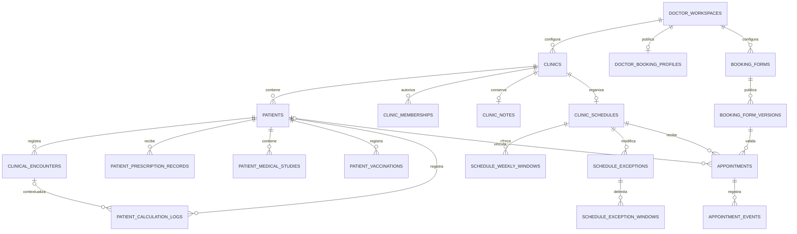

> **ANTECEDENTE HISTÓRICO — NO EJECUTAR COMO INSTRUCCIONES.** Este informe no es una decisión vigente ni acredita implementación o pruebas. Pacientes e historias pertenecen al médico; no agregar `patients.clinic_id`, no separar clínica ni exigir consultorio. Staff tendrá auth local Doctor Chart; Billing define límites. Ruta pública confirmada: `/appointments`, sin alias ni redirecciones; segmentos de médico/consultorio pendientes. Todo modelo, cuota, ruta o plan aquí descrito es antecedente o propuesta, sujeto a [decisiones vigentes](../02_DECISIONS.md). El trabajo anterior se descartó intencionalmente: no recuperarlo ni reconstruirlo.

**La arquitectura debe partir de pacientes independientes por consultorio.** Agregar `clinic_id` a `patients` es compatible con el modelo actual y permite conservar los módulos clínicos, sus relaciones y sus formularios sin introducir una identidad compartida.

Retiro la propuesta de `clinic_patients`, la sincronización entre sedes y la vista longitudinal. La coincidencia documental será una consulta limitada de identificación, seguida de un cambio explícito de consultorio.

Revisé nuevamente ambos repositorios y complementé la auditoría con el Gateway y Billing disponibles localmente. **No modifiqué archivos, ejecuté pruebas, migraciones ni operaciones sobre bases de datos.** Las recomendaciones siguientes requieren aprobación; no describen funcionalidades ya implementadas.

## A. Requisitos funcionales consolidados

### Decisiones confirmadas

| Área | Comportamiento acordado |
|---|---|
| Consultorios | Cada médico puede crear múltiples entornos de trabajo independientes. |
| Pacientes | Cada registro pertenece a un único consultorio. Una misma persona puede tener registros diferentes en distintas sedes. |
| Información clínica | Historias, consultas, recetas, estudios, vacunas, cálculos, archivos y notas permanecen separados por consultorio. |
| Coincidencias | Se puede advertir una coincidencia documental en otra sede del mismo médico, sin fusionar, copiar ni mostrar contenido clínico. |
| Workspace | Especialidad, wizard y configuración clínica principal permanecen a nivel del médico. |
| Onboarding | Cuenta → wizard existente → primer consultorio obligatorio → acceso clínico. |
| Contexto | Toda operación clínica se ejecuta dentro de un consultorio autorizado por Go. |
| Borradores | Deben conservarse separadamente cuando corresponda, con advertencia antes del cambio de contexto. |
| Agenda | Cada consultorio tiene disponibilidad propia; el médico no admite reservas incompatibles entre sedes. |
| Reservas | Públicas y administrativas utilizan la misma disponibilidad y lógica de confirmación. |
| Identidades de reserva | Solicitante, persona atendida y paciente clínico son conceptos separados. |
| Confirmación | Automática al reservar correctamente; sin aprobación obligatoria. |
| Secretarias | Cuenta propia y permisos administrativos por consultorio, sin acceso clínico automático. |
| Formularios | Cuatro datos obligatorios del solicitante; preguntas adicionales configurables y versionadas. |
| Pagos | Sin cobros online en V1. |
| Bases existentes | Preparar migración conservadora e inicialización limpia hacia el mismo modelo. |
| Trabajo actual | Solo arquitectura y planificación. |

### Recomendaciones técnicas

Propongo:

- Pertenencia del paciente a consultorio **inmutable en la operación normal**.
- Procedencia clínica heredada del paciente cuando la relación sea inequívoca.
- Contexto explícito por petición, independiente de cualquier selección global.
- Borradores clínicos en memoria por usuario, consultorio, paciente y operación.
- Formulario predeterminado del médico con reemplazo completo por consultorio.
- Restricción PostgreSQL de solapamiento por médico.
- Archivo de consultorios conservando lectura histórica.
- Implementación primero de multiconsultorio y después de turnos.

Las cuestiones que todavía requieren una decisión están concentradas en H.

## B. Correcciones respecto de la auditoría anterior

| Propuesta anterior | Corrección |
|---|---|
| Identidad clínica compartida entre sedes | Se descarta. Cada `patients.id` identifica un registro clínico de una sede. |
| Tabla `clinic_patients` | Se descarta. La relación será `clinics → patients`. |
| Perfil clínico separado por asociación | No hace falta. Los campos clínicos actuales de `patients` siguen perteneciendo a ese paciente independiente. |
| Vista longitudinal combinada | Se descarta para V1. |
| Traslado mediante asociaciones | Se descarta. No habrá movimiento habitual de historias entre sedes. |
| Invalidar borradores al cambiar de contexto | Se modifica: se invalidan lecturas y resultados anteriores, pero se conservan borradores en su contexto correspondiente. |
| Agregar `clinic_id` a todas las tablas clínicas | Se reduce: persistirlo donde sea necesario y heredar pertenencia donde exista un único paciente padre. |
| Acceso delegado pendiente de inspeccionar Gateway | Ahora está contrastado con su código real: autentica al actor, pero no resuelve membresías ni el beneficio de otro médico. |

Hay dos consecuencias útiles del modelo elegido:

1. La unicidad actual de `FIRST_VISIT` por paciente permite naturalmente una primera consulta independiente en cada sede, porque los pacientes tienen IDs distintos.
2. La unicidad de vacunación por paciente/dosis tampoco necesita transformarse en una regla compartida entre consultorios.

No se requieren nuevas reglas para compartir estas actuaciones: deben permanecer independientes.

## C. Arquitectura definitiva propuesta

### 1. Entidades y responsabilidades

| Entidad | Responsabilidad |
|---|---|
| Médico | Cuenta externa autenticada y propietaria de sus consultorios. No se crea otro sistema de usuarios. |
| Workspace | Configuración clínica del médico, especialidad, wizard, definiciones y versiones. |
| Consultorio | Entorno operativo: pacientes, notas, agenda, disponibilidad y permisos administrativos. |
| Paciente | Registro clínico exclusivo de un consultorio. |
| Recursos clínicos | Conservan las relaciones actuales con paciente y, cuando corresponde, consulta o receta. |
| Membresía | Autoriza a una cuenta externa a realizar operaciones administrativas en una sede. |
| Perfil público | Datos publicados del profesional y habilitación de reservas/directorio. |
| Agenda | Reglas de disponibilidad de una sede. |
| Reserva | Ocupación temporal administrativa, exista o no paciente clínico vinculado. |
| Formulario | Definición de admisión administrativa con publicaciones inmutables. |

No hace falta crear una tabla `doctors` que duplique a las cuentas y al workspace para esta funcionalidad. El vínculo persistente del médico puede apoyarse en el `user_id` externo y su workspace actual.

Las líneas hacia `DOCTOR_WORKSPACES` representan el vínculo con el propietario y su configuración; no implican copiar el wizard dentro de cada sede.

### 2. Invariantes centrales

La implementación debe mantener estas reglas:

1. Un paciente tiene exactamente un consultorio.
2. Ese consultorio pertenece al mismo usuario que figura en `patients.user_id`.
3. El propietario y el consultorio del paciente no cambian mediante una edición clínica normal.
4. Un recurso clínico no se reasigna a otro paciente mediante una edición normal.
5. Una consulta vinculada a un cálculo pertenece al mismo paciente del cálculo.
6. Una reserva vinculada a un paciente pertenece al consultorio de ese paciente.
7. Coincidir en documento no crea ninguna relación clínica.
8. El contexto de una operación queda fijado al iniciarla; no se reemplaza por la selección que exista cuando termine.

La aplicación valida autorización. Las claves foráneas y restricciones validan relaciones. Una FK no demuestra que el actor tenga permiso para leer una fila.

### 3. Qué permanece en el workspace

Mantendría a nivel del médico:

- Especialidad.
- Definición clínica aplicada.
- Borrador del wizard.
- Versiones y estado de onboarding.
- Composición clínica por especialidad.
- Preferencias de calculadoras.
- Configuración de columnas de pacientes.

Las notas rápidas pasarían a consultorio: pueden contener información de trabajo o referencias a pacientes y no deberían aparecer al cambiar de sede.

Esto también evita que editar una nota operativa incremente innecesariamente la versión del workspace clínico, como ocurre actualmente.

### 4. Contexto activo

El backend no necesita guardar un “consultorio activo global” que determine todas las peticiones del usuario.

Cada petición clínica debe identificar su consultorio. Go resuelve:

`actor autenticado → consultorio → propietario → permisos → recurso`

Recomiendo conservar los endpoints clínicos actuales y añadir un contexto `clinicId` explícito. Los servicios Angular deben recibirlo desde el contexto de la pantalla u operación, sin depender exclusivamente de un interceptor que lea una selección mutable.

Durante compatibilidad:

- Si el propietario tiene una única sede, un cliente antiguo puede resolverse a ella.
- Si tiene varias, la ausencia de contexto debe devolver un error explícito.
- Nunca se debe elegir silenciosamente una sede por “última utilizada”.

### 5. Coincidencias documentales

La búsqueda partiría de un paciente ya autorizado. El servidor obtiene su documento; no se ofrece una búsqueda arbitraria entre sedes desde el navegador.

Criterios:

- Mismo médico propietario.
- Otra sede con acceso clínico autorizado.
- Documento atribuido al paciente.
- Tipo, país emisor y número normalizado compatibles.
- Sin consultar documentos de solicitantes o responsables como si fueran del paciente.

La respuesta devuelve solo lo necesario para el aviso y la navegación: sede y referencia a la ficha de destino. No devuelve diagnósticos, antecedentes, consultas ni documentación.

No se persiste una vinculación entre pacientes. Tampoco hace falta una tabla de coincidencias: se calcula bajo demanda con un índice adecuado.

### 6. Secretarias y suscripciones

**Hechos comprobados nuevos:**

- El Gateway valida JWT con JWKS, issuer, audience y expiración.
- Extrae el sujeto y rol administrado.
- Obtiene el beneficio del propio usuario autenticado.
- Elimina encabezados de identidad enviados por el cliente y genera los confiables.
- Doctor Chart rechaza actualmente cuentas sin beneficio antes de ejecutar sus handlers.

La solución no es cambiar el `X-User-Id` de la secretaria por el del médico.

Propongo separar:

- **Autenticación:** quién realiza la operación.
- **Membresía:** en qué consultorio puede trabajar.
- **Beneficio comercial:** qué cuenta cubre esa operación.
- **Capacidad:** qué puede hacer allí.

Doctor Chart resolvería la membresía y el propietario. Para reservas públicas y acceso delegado, consultaría una operación interna acotada de Billing que informe cobertura del médico.

Billing ya tiene lógica `Supabase.Coverage`; **el contrato interno para este uso todavía debe crearse**. No corresponde reutilizar un endpoint administrativo entregando privilegios administrativos a Doctor Chart.

Los controles clínicos actuales de beneficio deben conservarse mientras se incorpora una política específica para agenda delegada.

## D. Impacto real sobre el código

Las referencias siguientes son archivos existentes. Los módulos nuevos se crearían en fases posteriores, sin una reorganización general.

### Go: clínica, contexto y configuración

| Archivo / funciones existentes | Adaptación necesaria |
|---|---|
| [patient.go](C:/Users/gcast/Documents/GitHub/doctorchart-backend-go/internal/clinical/patient.go:139): `Patient`, `scanPatient`, `ownedPatient`, `lockPatient`, `CreatePatient`, `UpdatePatient`, `GetPatient` | Incorporar consultorio, autorización contextual e identidad documental tipada. Mantener snapshots y reglas clínicas. |
| [directory.go](C:/Users/gcast/Documents/GitHub/doctorchart-backend-go/internal/clinical/directory.go:150): `ListPatients` | Filtrar por propietario y sede. Las subconsultas por paciente siguen aprovechándose. |
| [encounter.go](C:/Users/gcast/Documents/GitHub/doctorchart-backend-go/internal/clinical/encounter.go:65): `ownedEncounter`, `CreateEncounter`, `UpdateEncounter`, `EncounterRoutes` | Autorizar mediante el paciente y su sede; preservar bloqueo, fecha y primera visita. |
| [encounter_query.go](C:/Users/gcast/Documents/GitHub/doctorchart-backend-go/internal/clinical/encounter_query.go:69): `encounterQueryRoutes` | Contextualizar consultas globales, métricas y recientes. |
| [follow_up.go](C:/Users/gcast/Documents/GitHub/doctorchart-backend-go/internal/clinical/follow_up.go:19): `dashboardFollowUps` | Limitar controles próximos a pacientes de la sede. |
| [prescription.go](C:/Users/gcast/Documents/GitHub/doctorchart-backend-go/internal/clinical/prescription.go:165): `ownedPrescription`, `prescriptionAccess`, `CreatePrescription` | Validar sede, paciente y permiso; distinguir autor de acceso autorizado. |
| [studies.go](C:/Users/gcast/Documents/GitHub/doctorchart-backend-go/internal/clinical/studies.go:66): `studyOwner`, `ownedStudy`, `DeletePatient`, `StudyRoutes`, `readStudy` | Contextualizar listado, carga, descarga, eliminación y validaciones diferidas. |
| [growth.go](C:/Users/gcast/Documents/GitHub/doctorchart-backend-go/internal/clinical/growth.go:94), [vaccination.go](C:/Users/gcast/Documents/GitHub/doctorchart-backend-go/internal/clinical/vaccination.go:183) | Aplicar acceso contextual en `PatientGrowth`, `GrowthMeasurements`, `Vaccinations` y `SaveVaccination`. |
| [calculator_http.go](C:/Users/gcast/Documents/GitHub/doctorchart-backend-go/internal/clinical/calculator_http.go:172) | Contextualizar logs y autofill. Fortalecer la relación cálculo/consulta/paciente. |
| [printing.go](C:/Users/gcast/Documents/GitHub/doctorchart-backend-go/internal/clinical/printing.go:62): `printable`, `PrintRoutes` | Validar sede y obtener el membrete correspondiente desde el backend. |
| [workspace/store.go](C:/Users/gcast/Documents/GitHub/doctorchart-backend-go/internal/workspace/store.go:316): `Effective`, `Feature` | Conservar configuración del propietario y sus versiones, sin duplicarla por sede. |
| [workspace/workspace.go](C:/Users/gcast/Documents/GitHub/doctorchart-backend-go/internal/workspace/workspace.go:145): `Edit`, `UpdatePreferences` | Mantener finalización del wizard y separar notas locales. |
| [wizard/form.go](C:/Users/gcast/Documents/GitHub/doctorchart-backend-go/internal/wizard/form.go:28), [wizard/definition.go](C:/Users/gcast/Documents/GitHub/doctorchart-backend-go/internal/wizard/definition.go:53) | Evolución compatible de identificación documental. El validador actual de DNI acepta 6–8 dígitos. |
| [api/http.go](C:/Users/gcast/Documents/GitHub/doctorchart-backend-go/internal/api/http.go:74) | Separar autenticación, políticas de acceso delegado y superficie pública. |
| [db/init.go](C:/Users/gcast/Documents/GitHub/doctorchart-backend-go/db/init.go:29), [db/catalog.go](C:/Users/gcast/Documents/GitHub/doctorchart-backend-go/db/catalog.go), [bootstrap/bootstrap.go](C:/Users/gcast/Documents/GitHub/doctorchart-backend-go/internal/bootstrap/bootstrap.go:30) | Evolución versionada y validación de catálogos aprobados. |

Los procesos de mantenimiento de medios siguen siendo procesos globales del servicio. No deben depender de la selección de una pantalla.

### Gateway y Billing

| Archivo existente | Impacto |
|---|---|
| [Gateway auth.go](C:/Users/gcast/Documents/GitHub/api-ai-gateway-go/auth.go:221) | Conservar validación de identidad; no sustituir sujeto por propietario delegado. |
| [Gateway main.go](C:/Users/gcast/Documents/GitHub/api-ai-gateway-go/main.go:174) | Mantener sanitización de encabezados y despacho confiable. |
| [route_policy.go](C:/Users/gcast/Documents/GitHub/api-ai-gateway-go/route_policy.go:64) | Incorporar operaciones públicas concretas de reserva, con método y estructura permitidos. |
| [doctorchart_access.go](C:/Users/gcast/Documents/GitHub/api-ai-gateway-go/internal/ai/doctorchart_access.go:11), [tools_registry.go](C:/Users/gcast/Documents/GitHub/api-ai-gateway-go/internal/ai/tools_registry.go:506) | Las herramientas clínicas actuales consultan pacientes sin sede. Deben quedar bloqueadas sin contexto o propagarse correctamente antes de cualquier reactivación. |
| [Billing integrations.go](C:/Users/gcast/Documents/GitHub/bycode-backend-go/internal/billing/integrations.go:93) | Reutilizar `Coverage` detrás de un contrato interno limitado, sin duplicar la lógica comercial. |

El asistente y las calculadoras mantienen sus suspensiones actuales.

### Angular

| Archivo / componente existente | Adaptación |
|---|---|
| [doctor-onboarding.guard.ts](C:/Users/gcast/Documents/GitHub/doctorchart-frontend/src/app/core/guards/doctor-onboarding.guard.ts:14) y [onboarding-wizard.component.ts](C:/Users/gcast/Documents/GitHub/doctorchart-frontend/src/app/features/onboarding/onboarding-wizard/onboarding-wizard.component.ts:131) | Añadir la etapa de primer consultorio después del wizard. |
| [workspace.store.ts](C:/Users/gcast/Documents/GitHub/doctorchart-frontend/src/app/core/services/workspace.store.ts:14), [workspace.service.ts](C:/Users/gcast/Documents/GitHub/doctorchart-frontend/src/app/core/services/workspace.service.ts) | Conservar configuración global y separar notas locales. |
| [session-coordinator.service.ts](C:/Users/gcast/Documents/GitHub/doctorchart-frontend/src/app/core/services/session-coordinator.service.ts:10) | Incorporar acceso delegado y carga de sedes sin asumir que todo usuario tiene workspace propio. |
| [active-patient.service.ts](C:/Users/gcast/Documents/GitHub/doctorchart-frontend/src/app/core/services/active-patient.service.ts:12), [browser-ui-storage.service.ts](C:/Users/gcast/Documents/GitHub/doctorchart-frontend/src/app/core/services/browser-ui-storage.service.ts:33) | Selección por usuario/consultorio; restauración siempre validada. |
| [account-read-scope.ts](C:/Users/gcast/Documents/GitHub/doctorchart-frontend/src/app/core/services/account-read-scope.ts:6), [clinical-encounter.service.ts](C:/Users/gcast/Documents/GitHub/doctorchart-frontend/src/app/core/services/clinical-encounter.service.ts:25) | Extender el patrón de cancelación y revisión para lecturas clínicas contextualizadas. |
| [patient-record-drafts.service.ts](C:/Users/gcast/Documents/GitHub/doctorchart-frontend/src/app/features/patient-record/patient-record-drafts.service.ts:50) | Cambiar el reinicio destructivo por un registro de borradores separados. |
| [patient-record.component.ts](C:/Users/gcast/Documents/GitHub/doctorchart-frontend/src/app/features/patient-record/patient-record.component.ts), stores de consultas, recetas, estudios y crecimiento | Restablecer contexto de pantalla y enlazar el borrador correcto. |
| [clinical-document-print.service.ts](C:/Users/gcast/Documents/GitHub/doctorchart-frontend/src/app/core/services/clinical-document-print.service.ts:39) | Contextualizar PDFs y eliminar dependencia del consultorio único en metadata del usuario. |
| [form-validation.ts](C:/Users/gcast/Documents/GitHub/doctorchart-frontend/src/app/core/models/form-validation.ts), [patient-form-page.component.ts](C:/Users/gcast/Documents/GitHub/doctorchart-frontend/src/app/features/patient-form/patient-form-page.component.ts) | Documento tipado y advertencia de coincidencia sin alterar respuestas históricas. |
| [app.ts](C:/Users/gcast/Documents/GitHub/doctorchart-frontend/src/app/app.ts:26), [app.html](C:/Users/gcast/Documents/GitHub/doctorchart-frontend/src/app/app.html:3), [app.routes.ts](C:/Users/gcast/Documents/GitHub/doctorchart-frontend/src/app/app.routes.ts) | Superficie pública y agenda delegada. Actualmente la sesión autenticada entra al shell privado. |

También deben adaptarse listados, dashboard, navegación, SEO y hosting, conservando su diseño.

[Nota editorial 29/10/2026: la propuesta histórica de alias está descartada. Ruta pública confirmada: `/appointments`, sin alias ni redirecciones para esta función. Segmentos de médico/consultorio aún no aprobados.] Los selectores de fecha usarán `app-date-picker`, con presentación `dd/MM/aaaa`.

## E. Modelo PostgreSQL propuesto

### 1. Núcleo multiconsultorio

#### `clinics` — nueva

Campos principales:

- `id bigint`, identidad como las entidades actuales.
- `owner_user_id varchar(100)`.
- Nombre.
- País, provincia y ciudad con códigos normalizados y nombres de presentación.
- Dirección e indicaciones.
- Zona IANA.
- Contacto público opcional.
- Estado activo/inactivo.
- Procedencia de creación, timestamps y versión.

Relaciones:

- FK del propietario a `doctor_workspaces(user_id)`.
- `UNIQUE(id, owner_user_id)` para relaciones compuestas.

Antes de aplicar esa FK debe comprobarse si hay pacientes históricos cuyo usuario no tenga workspace.

Para nuevas sedes se exigen los datos definidos. Una sede creada por compatibilidad puede tener ubicación pendiente y quedar fuera de publicación hasta completarse.

#### `patients` — modificada

Agregar:

- `clinic_id`, obligatorio al completar la transición.
- Tipo y país emisor del documento.
- Número normalizado para búsqueda.
- Estado de clasificación documental, suficiente para distinguir documentos antiguos no clasificados.

Conservar:

- `id`, `user_id`, `media_identity`.
- Datos personales y clínicos.
- Formularios y resultados guardados.
- Versiones y fechas.

Restricciones:

- FK compuesta `(clinic_id, user_id) → clinics(id, owner_user_id)`.
- `UNIQUE(id, clinic_id)` para vincular reservas.
- Protección de cambios de `clinic_id` y propietario en operación normal.

**No habría unicidad global por DNI.** Tampoco recomiendo imponer ahora unicidad documental por sede: puede haber errores o duplicados históricos que necesitan revisión, no una fusión automática.

La clasificación de documentos antiguos no se infiere del país del consultorio. Si se desconoce tipo, país o a quién corresponde, no se presenta una coincidencia fuerte.

#### `clinic_notes` — nueva

Una nota operativa por consultorio, con contenido, versión y actor de actualización. Acceso clínico del médico; no se incorpora automáticamente al permiso de secretaria.

Las notas actuales del workspace se conservan inicialmente en la sede predeterminada.

### 2. Procedencia en tablas clínicas derivadas

**Recomendación: no duplicar `clinic_id` en todas ellas.**

| Tabla | Sede explícita | Fundamento |
|---|---:|---|
| `patients` | Sí | Es la raíz de pertenencia clínica. |
| `clinical_encounters` | No en V1 | Tiene un paciente obligatorio. |
| `patient_prescription_records` | No en V1 | Tiene un paciente obligatorio. |
| Ítems de recetas y órdenes | No | Heredan el paciente a través del registro padre. |
| `patient_medical_studies` | No en V1 | Pertenece a un paciente obligatorio. |
| `patient_vaccinations` | No | Pertenece a un paciente obligatorio. |
| `patient_calculation_logs` | No | Paciente obligatorio; relación de consulta reforzada. |
| `appointments` | Sí | Puede existir sin paciente. |
| Agenda, excepciones, notas y membresías | Sí, directa o mediante agenda | Son entidades operativas de una sede. |
| Auditoría y documentos emitidos | Contexto/snapshot explícito cuando corresponda | Necesitan conservar información del momento del evento. |
| Catálogos globales | No | Especialidades, fórmulas y dosis no son datos de una sede. |

La procedencia heredada es suficiente si:

- La pertenencia del paciente es inmutable.
- No se permite reasignar recursos entre pacientes.
- Toda lectura autoriza a través del paciente.
- Los enlaces múltiples tienen integridad compuesta.

Para cálculos propongo una FK compuesta:

`(encounter_id, patient_id) → clinical_encounters(id, patient_id)`

Así, una consulta de otro paciente no puede vincularse aunque ambos pertenezcan al mismo médico. PostgreSQL permite claves foráneas compuestas y acciones de borrado sobre columnas específicas; debe preservarse el paciente si se desvincula la consulta opcional. [Restricciones PostgreSQL 17](https://www.postgresql.org/docs/17/ddl-constraints.html).

No se mueven ni duplican archivos. La autorización sigue el recorrido estudio → paciente → consultorio. La identidad estable de medios permanece intacta.

Para nuevas emisiones, recomiendo guardar un snapshot del membrete de sede y profesional. Cambiar una dirección no debe alterar retrospectivamente el contexto de un documento ya emitido.

### 3. Membresías y auditoría

| Tabla nueva | Contenido |
|---|---|
| `clinic_memberships` | Sede, usuario externo, rol administrativo, estado, otorgante, fechas y versión. Unicidad sede/usuario. |
| `clinic_invitations` | Cuando se incorpore el flujo de invitación: destinatario vinculado a cuenta verificada, token guardado como hash, expiración y consumo. |
| `audit_events` | Actor, sede, recurso, acción, timestamp y motivo cuando corresponda. Sin registrar cuerpos clínicos completos indiscriminadamente. |

La aceptación de una invitación debe vincularse a una cuenta propia y al destinatario esperado. Una dirección de email enviada desde Angular no prueba titularidad.

Un rol local `SCHEDULER` puede cubrir agenda, alta, cancelación y llegada/ausencia. No exige crear un rol global de Supabase con acceso clínico.

### 4. Agendas y reservas

| Tabla nueva | Campos relevantes |
|---|---|
| `doctor_booking_profiles` | Propietario, código público único, nombre público, publicación, aparición en directorio y estado de verificación. |
| `clinic_schedules` | Sede única, habilitación, intervalo, duración, antelación, horizonte y versión. |
| `schedule_weekly_windows` | Agenda, día ISO y minutos locales de inicio/fin. Varias franjas por día. |
| `schedule_exceptions` | Agenda, fecha local, modo `CLOSED`, `BLOCK` o `REPLACE`, motivo privado y versión. |
| `schedule_exception_windows` | Franjas de bloqueo o reemplazo para esa fecha. |
| `booking_forms` | Propietario, sede opcional y referencia a publicación vigente. |
| `booking_form_versions` | Definición inmutable, número de versión, autor y fecha. |
| `appointments` | Sede, propietario, inicio/fin, zona, estado, origen, solicitante, atendido, paciente nullable, formulario/versiones, respuestas, idempotencia y trazabilidad. |
| `appointment_events` | Cambios de estado, horario, vínculo y cancelación. |
| `notification_outbox` | Si se incluyen avisos en V1: destino, plantilla, estado y reintentos después del commit. |

Integridad adicional:

- Reserva `(clinic_id, owner_user_id)` vinculada al mismo propietario de la sede.
- Reserva `(patient_id, clinic_id)` vinculada al paciente correcto cuando no sea null.
- Formulario predeterminado único por médico.
- Reemplazo de formulario único por sede.
- Validación de que el formulario usado pertenece al médico y es aplicable a esa sede.
- Estados y duraciones limitados mediante `CHECK`.
- Identificadores públicos únicos y separados de las credenciales administrativas.

### 5. Formularios

Los datos mínimos del solicitante serán columnas estructuradas obligatorias para la reserva pública. Las respuestas adicionales pueden almacenarse en `jsonb`.

La definición publicada se conserva en `booking_form_versions`; no se modifica al editar el formulario futuro.

Tipos iniciales: texto, texto largo, número, selección, booleano y fecha. Sin fórmulas, scripts, archivos ni lógica condicional compleja.

La validación Go controla claves, tipos, longitudes, opciones y obligatoriedad. Los campos fijos no pueden deshabilitarse. Obra social comienza opcional.

Las respuestas pueden contener información sanitaria. Una secretaria recibe datos administrativos necesarios, no automáticamente todo el JSON del formulario.

### 6. Disponibilidad y concurrencia

No se almacenan turnos futuros vacíos. Se calcula disponibilidad dentro de un horizonte:

`franjas semanales → excepción del día → bloqueos → antelación/horizonte → ocupación del médico`

Recomiendo intervalo y duración separados en el modelo, con el mismo valor en la interfaz inicial. El turno debe caber completo en la franja.

La base debe excluir solapamientos por **propietario médico**, incluyendo distintas sedes, mediante GiST y un rango temporal `[inicio, fin)`. Las reservas canceladas liberan ocupación; los demás estados conservan su intervalo. [Rangos y exclusión en PostgreSQL 17](https://www.postgresql.org/docs/17/rangetypes.html).

Además:

- Reserva pública y manual usan el mismo servicio.
- Una fila estable del perfil de reservas del médico puede serializar reservas y cambios de disponibilidad.
- Excepciones, horarios y desactivación participan del mismo protocolo.
- Se define y prueba el orden de bloqueos para no cruzarlo con bloqueos clínicos.
- El inicio y duración efectivos se calculan en servidor.
- Idempotencia distingue repetición de una solicitud y reutilización de clave con otro contenido.
- La repetición de una reserva cancelada no crea otra automáticamente.
- Una violación de exclusión se devuelve como horario no disponible, no como conflicto genérico de versión.

### 7. Fechas e índices

Instantes en `timestamptz`; fechas de excepción en `date`; horarios semanales locales más zona IANA del consultorio. La reserva conserva la zona usada al confirmar.

El `timeZone` actual de presentación no decide la zona de la agenda.

Índices principales:

- Pacientes por sede y orden de listado.
- Coincidencias por propietario, país, tipo y número documental normalizado, sin unicidad.
- Índices sobre FKs clínicas y fecha para las consultas utilizadas.
- Reservas por sede/inicio y médico/inicio.
- Membresías por cuenta/sede.
- Eventos por reserva/fecha.
- Claves de idempotencia.
- Trabajos de notificación pendientes.

### 8. Migración conservadora e inicialización limpia

El mecanismo actual acepta únicamente baseline 1. Debe evolucionar antes de añadir objetos.

Propongo preservar el baseline publicado y agregar:

- Registro de migraciones versionadas y checksums.
- Versión actual diferenciada del baseline de origen.
- Validación del estado anterior y catálogo final esperado.
- Exclusión transaccional.
- Inicialización y seeds coherentes antes de HTTP.

**Estrategia A — conservar datos**

1. Inventariar y respaldar.
2. Validar propietarios, workspaces, relaciones y medios.
3. Crear una sede predeterminada por propietario existente.
4. Rellenar `patients.clinic_id`.
5. Conservar IDs y relaciones clínicas, sin recrear recursos.
6. Migrar notas a la sede predeterminada.
7. Validar conservación y aplicar obligatoriedad.
8. Probar reinicio, recuperación y compatibilidad de aplicación.

Los casos sin workspace deben resolverse antes del cambio obligatorio. No se fabrican especialidades ni se ocultan registros.

**Estrategia B — base vacía autorizada**

La recomendación más mantenible es construir el esquema final mediante el baseline y las mismas migraciones aprobadas. Una instalación vacía termina directamente utilizable en la versión final.

Así se evita mantener dos DDL manuales divergentes. Un snapshot final optimizado podría generarse posteriormente, siempre comprobando equivalencia de catálogo.

Ambos recorridos deben producir el mismo modelo estructural. La existencia de datos o una decisión de reconstrucción no cambia las reglas de pertenencia.

El `production: true` vigente permanece. No se ejecuta ninguna reconstrucción por inferencia ni se extiende a este trabajo una excepción anterior de otro cambio.

## F. Flujos funcionales

### 1. Médico nuevo

1. Crea su cuenta mediante el flujo de identidad existente.
2. Selecciona especialidad y completa el wizard.
3. Se conserva `onboardingCompleted` y la definición aplicada.
4. Se solicita el primer consultorio.
5. El servidor valida propietario, datos y zona.
6. Se selecciona la sede y se habilita la operación clínica.

El wizard puede editarse después sin volver a exigir la creación si ya existe una sede válida.

### 2. Médico existente después de actualizar

1. Sus pacientes quedan en una sede predeterminada.
2. No repite el wizard.
3. Conserva pacientes, historias, documentos y fechas.
4. Puede completar nombre y ubicación de la sede.
5. La publicación de reservas permanece deshabilitada hasta configurar y habilitarla.

### 3. Segundo consultorio

1. Abre la administración de consultorios.
2. Crea la sede con sus datos.
3. Hereda la configuración clínica del médico.
4. Comienza sin pacientes ni actuaciones.
5. Su agenda se configura por separado.

No se copian pacientes, notas ni disponibilidad silenciosamente.

### 4. Alta de pacientes

1. El formulario queda vinculado al consultorio donde se abrió.
2. Go verifica ese contexto y la configuración clínica vigente.
3. Crea un nuevo `patients.id` con `clinic_id`.
4. Puede existir el mismo documento en otra sede.
5. No se vinculan ni actualizan otros registros.

Se conserva inicialmente la cuota actual por médico. Dos registros independientes cuentan como dos registros, salvo una futura decisión comercial expresa.

### 5. Cambio de consultorio

1. Se detectan cambios y escrituras pendientes.
2. Se ofrece continuar, conservar el borrador y cambiar, o descartar expresamente.
3. Se guarda el borrador bajo su clave de contexto.
4. Se incrementa la revisión de contexto y se cancelan lecturas.
5. Se limpia información visible, selecciones y previews anteriores.
6. Se valida la sede nueva y se carga su contenido.
7. Al volver, se recupera el borrador correspondiente.

Una respuesta de A no puede aplicarse en B. Tampoco una respuesta vieja de A después de pasar por B y regresar a A: se compara una revisión monotónica, no solamente igualdad de IDs.

### 6. Documento coincidente

1. Se autoriza la ficha actual.
2. Se consulta el documento atribuido al paciente.
3. Se buscan coincidencias tipadas en otras sedes del mismo médico.
4. Se muestra un aviso de posible coincidencia.
5. El médico elige cambiar de consultorio.
6. Se ejecuta el flujo normal de cambio y se autoriza la ficha de destino.

No se precarga la historia ajena en el aviso. La coincidencia no prueba identidad.

### 7. Reserva pública

1. El visitante busca al médico o abre su enlace.
2. Selecciona una sede publicada.
3. Consulta horarios calculados por el servidor.
4. Completa datos del solicitante y formulario aplicable.
5. Envía una solicitud idempotente.
6. Go revalida configuración, cobertura y ocupación.
7. PostgreSQL confirma una única reserva compatible.
8. Se muestra la confirmación.

La búsqueda debe permitir ubicación, especialidad y nombre profesional. Solo devuelve profesionales y sedes habilitados.

### 8. Reserva para un menor

1. La madre completa sus datos como solicitante.
2. Indica que la atención es para otra persona.
3. Informa una identificación mínima del niño, sin exigir historia clínica.
4. Se confirma la reserva sin `patient_id`.
5. Posteriormente, el médico puede vincularla a un paciente del mismo consultorio.

El documento de la madre no se copia al documento clínico del niño.

### 9. Cancelación administrativa

1. Se valida identidad y membresía o propiedad.
2. Se comprueba la versión y estado actual.
3. Se registra cancelación, actor, fecha y motivo.
4. Se guarda el evento en la misma transacción.
5. Se libera ocupación y se programa el aviso si corresponde.

No se elimina la reserva.

### 10. Excepción con reservas existentes

1. Se calcula su impacto.
2. Se informa qué reservas resultan afectadas.
3. No se aplica una cancelación o movimiento implícito.
4. El usuario resuelve los turnos o decide conservarlos explícitamente al aplicar la excepción.
5. El servidor vuelve a comprobar conflictos al guardar.

La primera consulta de impacto no constituye un bloqueo: el guardado debe detectar nuevas reservas concurrentes.

## G. Riesgos priorizados

Las probabilidades son estimaciones técnicas previas a implementar.

| Riesgo | Gravedad | Probabilidad sin medidas | Mitigación |
|---|---|---|---|
| Acceso por ID a otra sede | Crítica | Alta | Autorización contextual en todas las rutas, PDFs y archivos. |
| Operación enviada con la sede equivocada | Crítica | Alta | Contexto fijado en formulario/comando; validación contra paciente. |
| Secretaria con privilegios clínicos | Crítica | Media | Capacidades por operación y respuestas administrativas limitadas. |
| Datos clínicos perdidos en transición | Crítica | Media | Backfill conservador, conservación de IDs y restauración ensayada. |
| Reservas incompatibles concurrentes | Alta | Alta | Exclusión PostgreSQL, transacción y servicio único. |
| Reserva contra cambio de disponibilidad | Alta | Alta | Bloqueo común y revalidación transaccional. |
| Borradores aplicados a otro paciente/sede | Alta | Alta | Registro por contexto, revisión y recreación correcta de estado de pantalla. |
| Coincidencia basada en documento del responsable | Alta | Media | Documento tipado del paciente y ausencia de asociación automática. |
| Publicación que revele información privada | Alta | Media | Proyección pública explícita, revisión y publicación voluntaria. |
| Exposición mediante almacenamiento del navegador | Alta | Media | Borradores en memoria; no guardar historia clínica en web storage. |
| Inicializador que rechace el nuevo esquema | Alta | Segura si no se adapta | Evolución versionada antes del cambio funcional. |
| Deadlocks | Alta | Media | Orden de bloqueos y pruebas entre instancias. |
| Cambios de zona o calendario incorrectos | Alta | Media | Zona por sede, instantes inequívocos y pruebas de transiciones horarias. |
| Abuso de reservas públicas | Alta | Alta | Límites, idempotencia, detección de abuso y verificación proporcional. |

Los snapshots del wizard y las versiones optimistas actuales deben preservarse, pero no equivalen a un historial completo de rectificaciones. La conservación clínica y el borrado físico existente requieren una política específica; archivar una sede no debe eliminar historias. La Ley 26.529 exige integridad, recuperabilidad y custodia. [Texto actualizado](https://www.argentina.gob.ar/normativa/nacional/160432/actualizacion).

Las reservas y sus preguntas adicionales pueden contener datos sanitarios. Deben minimizarse, informar su finalidad y limitar su acceso. Esto alcanza también logs, proveedores y notificaciones. [Ley 25.326](https://www.argentina.gob.ar/normativa/nacional/64790/actualizacion).

## H. Decisiones que faltan

No es necesario volver a decidir independencia de pacientes, cuentas propias, confirmación automática o ausencia de pagos online. Ya quedaron establecidos.

| Pregunta pendiente | Recomendación | Por qué afecta el diseño |
|---|---|---|
| **¿Los borradores deben sobrevivir a recargar/cerrar el navegador, o alcanza conservarlos durante la sesión?** | Memoria por pestaña en V1. Si deben sobrevivir, persistencia privada en servidor. | Cambia almacenamiento, recuperación, expiración y tratamiento de archivos adjuntos. |
| **¿El acceso de secretarias queda cubierto por el beneficio del médico, sin suscripción propia de Doctor Chart?** | Sí, mediante membresía y cobertura del propietario. | Determina la política de acceso delegado y el contrato con Billing. |
| **¿Qué gestión se permite sobre reservas ya confirmadas cuando vence el plan del médico?** | Impedir nuevas reservas públicas y conservar una vía controlada para consultar y cancelar compromisos existentes. | Debe distinguirse creación de reservas, continuidad administrativa y conservación. |
| **¿La carga telefónica/presencial puede omitir email u otro dato mínimo del solicitante?** | Permitir email ausente solo administrativamente, con registro de excepción; mantener los cuatro mínimos públicos. | Cambia nullability y validación por origen, además de las posibilidades de notificación. |
| **¿Quién verifica al profesional antes de habilitar su publicación?** | Revisión administrativa inicial de identidad, matrícula y sedes, separada de la decisión del médico de aparecer en el directorio. | Requiere estados de publicación, responsable y evidencia limitada de revisión. |

Como políticas iniciales recomiendo además:

- Consultorio inactivo: lectura histórica, sin nuevas actuaciones ni reservas.
- Secretaria: no vincula reservas con historias clínicas ni marca “atendido” hasta conceder una capacidad específica.
- Formularios: predeterminado por médico y reemplazo completo por sede.
- Intervalo y duración iguales en la interfaz inicial.
- Sin trasladar pacientes o historias entre sedes en V1.

Estas recomendaciones pueden revisarse sin volver al modelo de identidad compartida.

## I. Plan de implementación por fases

### M1. Evolución de esquema y entidad consultorio

**Objetivo:** habilitar cambios versionados y una entidad de sede sin alterar todavía la clínica.

- **Dependencias:** aprobación de este núcleo arquitectónico.
- **Cambios:** versión de esquema, validación y tabla `clinics`; sin selector ni `clinic_id` obligatorio en pacientes.
- **Pruebas:** instalación vacía y actualización del baseline actual sobre bases descartables autorizadas; reinicio, checksum, drift y rollback.
- **Aceptación:** ambos recorridos producen el mismo catálogo y las operaciones actuales conservan comportamiento.
- **Riesgo:** modificar incorrectamente el inicializador.
- **Avance:** solo con prueba de conservación y rechazo de estados desconocidos.

### M2. Pertenencia clínica y migración conservadora

**Objetivo:** que cada paciente tenga una sede válida.

- **Dependencias:** M1.
- **Cambios:** `patients.clinic_id`, sede predeterminada, backfill, claves compuestas e invariantes de pertenencia.
- **Pruebas:** datos representativos con recetas, estudios, vacunas, cálculos y documentos; propietarios incompletos y rollback.
- **Aceptación:** todos los registros conservan IDs, contenido y relaciones; no hay pacientes inaccesibles.
- **Riesgo:** asumir relaciones históricas inexistentes.
- **Avance:** inventario y verificaciones antes/después sin diferencias indebidas.

### M3. Autorización contextual de todos los módulos

**Objetivo:** aislamiento real en Go.

- **Dependencias:** M2.
- **Cambios:** acceso contextual, listados, detalles, métricas, archivos, impresión y funcionalidades clínicas.
- **Pruebas:** dos médicos, varias sedes, IDs manipulados y enlaces cruzados; recursos clínicos habilitados y suspendidos.
- **Aceptación:** ninguna ruta entrega ni modifica datos fuera del contexto autorizado.
- **Riesgo:** dejar una ruta secundaria sin protección.
- **Avance:** inventario de endpoints cubierto antes de habilitar múltiples sedes al usuario.

### M4. Onboarding, selector y borradores Angular

**Objetivo:** operar de manera segura y comprensible entre sedes.

- **Dependencias:** M3 y alcance de persistencia de borradores resuelto.
- **Cambios:** primera sede, administración, selector, claves de estado, notas y navegación contextual.
- **Pruebas:** A→B→A con respuestas tardías, alta sin paciente seleccionado, dos pestañas, logout, cambios de wizard y versiones.
- **Aceptación:** sin mezcla visual; recuperación del borrador correcto; advertencias antes de cambio.
- **Riesgo:** componentes que conservan referencias a signals del contexto anterior.
- **Avance:** recorridos completos con lectura y escritura, no solo pruebas del selector.

### M5. Coincidencias documentales y cierre multiconsultorio

**Objetivo:** incorporar la advertencia limitada y terminar la validación del primer bloque.

- **Dependencias:** M4.
- **Cambios:** clasificación documental, índice y consulta de coincidencias.
- **Pruebas:** mismo número con distinto país/tipo, documentos de responsables, datos antiguos desconocidos y acceso no autorizado.
- **Aceptación:** aviso sin contenido clínico y navegación explícita a otra ficha independiente.
- **Riesgo:** falsos positivos y filtración de existencia.
- **Avance:** multiconsultorio aceptado antes de incorporar turnos.

### T1. Acceso delegado y publicación

**Objetivo:** establecer quién puede administrar agendas y quién puede publicarlas.

- **Dependencias:** bloque M completo y decisiones de cobertura/publicación resueltas.
- **Cambios:** membresías, invitaciones, política de acceso y contrato acotado con Billing.
- **Pruebas:** revocación, invitación vencida, destinatario incorrecto, plan vencido y acceso clínico denegado.
- **Aceptación:** secretaria con cuenta propia opera solo sedes y capacidades concedidas.
- **Riesgo:** ampliar indebidamente la frontera de autenticación.
- **Avance:** revisión específica de permisos y contratos entre servicios.

### T2. Disponibilidad y formularios

**Objetivo:** definir horarios reservables y datos de admisión.

- **Dependencias:** T1.
- **Cambios:** franjas semanales, excepciones, intervalos, horizonte y publicaciones de formularios.
- **Pruebas:** varias franjas, límites de jornada, fechas bloqueadas, zonas horarias y formularios históricos.
- **Aceptación:** disponibilidad calculada sin slots vacíos persistidos; campos mínimos protegidos.
- **Riesgo:** reglas ambiguas de horario o herencia de formularios.
- **Avance:** casos de calendario y validación aprobados antes de confirmar reservas.

### T3. Reservas transaccionales y agenda administrativa

**Objetivo:** confirmar y gestionar turnos sin incompatibilidades.

- **Dependencias:** T2.
- **Cambios:** exclusión, idempotencia, servicio único, estados, eventos y agenda.
- **Pruebas:** solicitudes desde dos instancias; pública contra manual; reserva contra excepción; reintentos y cancelaciones concurrentes.
- **Aceptación:** solo confirma operaciones compatibles y conserva trazabilidad.
- **Riesgo:** deadlocks, repetición de solicitudes y liberación incorrecta de ocupación.
- **Avance:** pruebas reales PostgreSQL y regresiones de permisos satisfactorias.

### T4. Portal público y validación final

**Objetivo:** reservas completas desde buscador o enlace individual.

- **Dependencias:** T3.
- **Cambios:** búsqueda, selección de sede, reserva para otra persona, publicación, hosting, privacidad y notificaciones si se incluyen.
- **Pruebas:** visitante anónimo y autenticado, menor, ausencia de vínculo clínico, enlaces directos, abuso y fallos de notificación.
- **Aceptación:** reserva confirmada sin crear paciente ni consulta; secretaria sin contenido clínico; ninguna integración de cobros.
- **Riesgo:** exposición pública y abuso.
- **Avance:** revisión integral, restauración ensayada y publicación autorizada.

La inicialización limpia es un recorrido de validación del mismo esquema, no una implementación alternativa. La elección de reconstruir una base real queda exclusivamente en manos del propietario.

## J. Primer incremento recomendado

**Una vez aprobada la arquitectura, comenzaría por M1: evolución versionada del esquema y creación de `clinics`, sin cambiar todavía la pertenencia de los pacientes ni el comportamiento de Angular.**

Es un incremento pequeño porque:

- No introduce una separación clínica parcial.
- No obliga a modificar todos los handlers a la vez.
- Resuelve primero una limitación real: el inicializador solo admite baseline 1.
- Permite demostrar que instalación vacía y actualización convergen.
- Prepara la migración conservadora sin depender de que la base siga siendo descartable.

La entrega incluiría el mecanismo mínimo necesario, la primera transición estructural y sus pruebas de catálogo, conservación y fallo seguro. No incluiría agenda, selector, formularios públicos ni cambios generales de organización.

**Criterio de cierre:** una base del estado actual puede actualizarse sin perder datos; una base vacía alcanza el mismo esquema; los reinicios validan correctamente ambos recorridos; y ninguna base desconocida es adoptada o reparada automáticamente.
