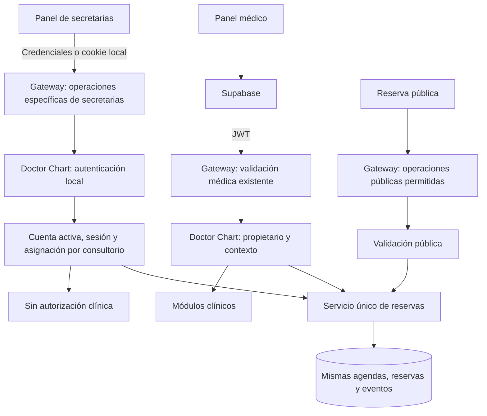
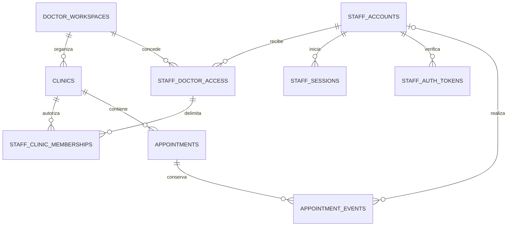

> **ANTECEDENTE HISTÓRICO — NO EJECUTAR COMO INSTRUCCIONES.** Este informe no es una decisión vigente ni acredita implementación o pruebas. Pacientes e historias pertenecen al médico; no agregar `patients.clinic_id`, no separar clínica ni exigir consultorio. Staff tendrá auth local Doctor Chart; Billing define límites. Ruta pública confirmada: `/appointments`, sin alias ni redirecciones; segmentos de médico/consultorio pendientes. Todo modelo, cuota, ruta o plan aquí descrito es antecedente o propuesta, sujeto a [decisiones vigentes](../02_DECISIONS.md). El trabajo anterior se descartó intencionalmente: no recuperarlo ni reconstruirlo.

**Queda incorporado: panel médico y panel de secretarias separados, con un único sistema de turnos compartido.** Registrar la llegada de Adriana solo modifica una reserva; no concede acceso a su historia clínica ni a la de su hijo.

El adjunto introduce además un cambio importante: **las secretarias tendrán cuentas locales de Doctor Chart, sin Supabase**. Esto sustituye la propuesta anterior de cuentas Bycode para ellas. La autenticación médica existente se conserva.

No modifiqué archivos. Revisé código y realicé comprobaciones HTTP `HEAD/OPTIONS` sin credenciales ni modificaciones de datos.

## 1. Dos accesos, un servicio de reservas

Propongo tres entradas al mismo servicio de negocio:

| Entrada | Identidad | Alcance |
|---|---|---|
| Panel médico | Supabase validado por el Gateway | Clínica y administración de sus turnos. |
| Panel de secretarias | Sesión local validada por Doctor Chart | Operaciones administrativas expresamente asignadas. |
| Reserva pública | Visitante, con controles de abuso | Consultar disponibilidad y reservar. |

Comparten:

- Tablas de reservas y agendas.
- Cálculo de disponibilidad.
- Restricciones de solapamiento.
- Idempotencia.
- Estados y eventos.
- Reglas de cancelación.

Cada entrada tiene autenticación, autorización y respuestas propias. No se duplican agendas ni se sincronizan reservas entre sistemas.

El médico puede gestionar todos sus turnos aunque tenga secretaria. Delegar no le quita capacidades.

## 2. Integración recomendada con el Gateway

### Lo comprobado

Actualmente:

- El Gateway exige JWT Supabase para las rutas privadas.
- Elimina encabezados de identidad enviados por el cliente y genera los confiables.
- Doctor Chart verifica el secreto del Gateway y después exige identidad y beneficio médico.
- No existen cuentas, credenciales ni sesiones locales de secretarias en el esquema auditado.

Esto se observa en [Gateway `main.go`](C:/Users/gcast/Documents/GitHub/api-ai-gateway-go/main.go:174), [su política de rutas](C:/Users/gcast/Documents/GitHub/api-ai-gateway-go/route_policy.go:48) y [el middleware de Doctor Chart](C:/Users/gcast/Documents/GitHub/doctorchart-backend-go/internal/api/http.go:78).

### Opciones evaluadas

| Opción | Evaluación |
|---|---|
| Exponer directamente otro acceso al backend, evitando el Gateway | Añade una segunda frontera de entrada y facilita inconsistencias. La descarto. |
| Hacer que el Gateway valide también sesiones locales de secretarias | Duplica responsabilidad o necesita introspección en cada petición. No es necesario inicialmente. |
| Mantener el Gateway como entrada y validar la sesión local exclusivamente en Doctor Chart | **Recomendada:** cambios acotados y una única autoridad sobre sesiones locales. |

### Contrato propuesto

Crear una familia específica, por ejemplo:

`/api/doctorchart/staff/...`

Es una propuesta de rutas nuevas; no existe actualmente.

El Gateway:

1. Valida método y estructura de la operación.
2. Aplica límites de admisión, CORS y controles de ruta.
3. No exige JWT Supabase para las operaciones locales reconocidas.
4. Elimina identidad médica, secretos y marcadores de autenticación enviados por el cliente.
5. Acredita su propia llamada mediante el secreto de transporte existente.
6. Reenvía la petición al router específico de secretarias.

Doctor Chart:

1. Exige la procedencia confiable del Gateway, incluso en login y recuperación.
2. Distingue operaciones de autenticación de operaciones administrativas.
3. Valida la sesión local cuando corresponde.
4. Resuelve permisos y cobertura comercial.
5. Ejecuta exclusivamente operaciones administrativas.

**No se debe declarar todo `/staff/*` como público en el middleware genérico.** Debe existir una política explícita de operaciones y un router con autenticación local obligatoria.

Una ruta local desconocida falla cerrada. No cae como alternativa en los handlers médicos.

### Separación de credenciales

- Una cookie local nunca genera `X-User-Id` del médico.
- Una sesión local nunca produce roles `DOCTOR`, `USER` o `AUTHENTICATED` para reutilizar los controles clínicos existentes.
- Las rutas médicas continúan exigiendo su autenticación actual.
- Las rutas administrativas locales no aceptan un JWT médico como sustituto de sesión de secretaria.
- Las operaciones del médico para administrar secretarias permanecen bajo autenticación médica.

El Gateway también debe evitar reenviar la cookie de secretarias a Billing, Pointly, Supabase o IA. El nombre reservado de esa cookie no debería poder establecerse desde respuestas de otros servicios.

## 3. Cuentas locales y modelo PostgreSQL

### Una cuenta local, varias asignaciones

Recomiendo que una secretaria tenga **una cuenta local de Doctor Chart**, identificada por email verificado, y asignaciones independientes a médicos y consultorios.

Así puede trabajar para dos profesionales sin duplicar credenciales. Sin embargo:

- Cada médico administra únicamente su relación con ella.
- Ninguno conoce ni cambia su contraseña.
- Ninguno puede consultar sus otros empleadores.
- Revocar una relación no desactiva la cuenta para los demás.
- Coincidir con un email de Supabase no vincula ambas identidades.

No hace falta habilitar una experiencia completa para varios médicos desde el primer día, pero el esquema puede soportarla sin complejidad excesiva.

### Tablas propuestas

| Tabla | Responsabilidad y campos principales |
|---|---|
| `staff_accounts` | `id bigint`, email original y canónico único, estado, verificación de email, hash Argon2id, versión de credenciales y timestamps. |
| `staff_doctor_access` | Relación secretaria–propietario: cuenta local, usuario médico, estado pendiente/activo/revocado, creador, fechas y versión. |
| `staff_clinic_memberships` | Consultorios asignados dentro de esa relación, rol administrativo y estado. |
| `staff_sessions` | Sesiones opacas: hash del identificador, cuenta, versión de credenciales, creación, actividad, vencimientos y revocación. |
| `staff_auth_tokens` | Activación, aceptación de invitación y recuperación: propósito, hash, destinatario, relación correspondiente, vencimiento y consumo. |
| `staff_auth_throttles` | Contadores compartidos de intentos y bloqueos temporales, con expiración. |
| Auditoría existente propuesta | Eventos de seguridad y administración, identificando correctamente al actor local. |

Para una única contraseña por cuenta, **no hace falta separar inicialmente una tabla de credenciales**. Puede guardarse el hash en `staff_accounts`. Se extraería si posteriormente aparecen varios métodos de autenticación.

Los nombres son propuestos; no describen tablas actuales.

### Integridad necesaria

- Email canónico único en cuentas locales.
- Relación médico–secretaria única.
- Asignación única por relación y consultorio.
- FKs compuestas que impidan asignar a esa relación una sede de otro médico.
- Sesiones y tokens asociados a cuentas válidas.
- Tokens de invitación vinculados al médico que invita.
- Consumo de tokens transaccional y de un solo uso.
- Revocación sin eliminar eventos históricos.

Los eventos deben distinguir actores, por ejemplo:

- `DOCTOR_SUPABASE`.
- `STAFF_LOCAL`.
- `PUBLIC`.
- `SYSTEM`.

No se introduce el identificador numérico local en un campo que signifique “usuario Supabase”. Las referencias y restricciones deben reflejar esa diferencia.

La incorporación de estas tablas seguirá el mecanismo versionado y de fingerprint ya planificado.

## 4. Contrato de autorización

Toda operación administrativa debe resolver:

`actor local → sesión → relación con médico → consultorio → capacidad → reserva`

El propietario se obtiene de las relaciones del servidor. Un `ownerId` enviado por el navegador no concede autoridad.

### Capacidades iniciales

| Operación | Médico propietario | Secretaria asignada |
|---|---:|---:|
| Consultar agenda y disponibilidad | Sí | Sí |
| Consultar datos administrativos necesarios | Sí | Sí |
| Crear turno manual | Sí | Sí |
| Cancelar turno | Sí | Sí |
| Marcar presente o ausente | Sí | Sí |
| Marcar atendido | Sí | No inicialmente |
| Cambiar horarios o excepciones | Sí | No inicialmente |
| Configurar formularios | Sí | No |
| Vincular reserva con paciente clínico | Sí | No inicialmente |
| Abrir ficha, recetas, estudios o PDFs clínicos | Sí | No |
| Consultar coincidencias documentales entre sedes | Sí | No |
| Administrar secretarias | Sí | No |

### La llegada pertenece a la reserva

La operación correcta es:

`marcar presente appointment_id`

No requiere consultar `patients`, buscar una historia por nombre ni resolver el documento clínico.

La secretaria puede ver que:

> Adriana solicitó un turno para Mateo, hoy a las 15:20.

Eso no habilita ninguna lectura clínica sobre Adriana o Mateo.

Si el médico vinculó la reserva con un paciente, el vínculo sigue siendo interno. La respuesta administrativa no necesita entregar `patient_id`, URLs de ficha, antecedentes ni indicadores clínicos.

### Respuestas administrativas específicas

No debe enviarse el DTO clínico y ocultar campos con Angular.

El backend debe construir una respuesta administrativa que permita exclusivamente:

- Solicitante y contacto.
- Persona que recibirá la atención.
- Sede, horario y estado.
- Observaciones administrativas permitidas.
- Datos de cobertura que se hayan clasificado como administrativos.

Las preguntas adicionales del formulario se clasifican. Los campos personalizados deberían considerarse restringidos por defecto: un profesional puede escribir una pregunta sanitaria bajo un nombre aparentemente administrativo.

## 5. Creación, activación y recuperación

### Alta por el médico

1. El médico entra mediante Supabase como hasta ahora.
2. Indica email y consultorios.
3. Go valida que todas las sedes sean propias.
4. Crea una cuenta pendiente o reutiliza la cuenta local existente sin revelar relaciones ajenas.
5. Crea la relación pendiente y sus asignaciones.
6. Envía una activación o invitación al destinatario.

El médico no establece ni recibe una contraseña permanente.

### Activación de una cuenta nueva

1. La secretaria recibe un enlace temporal de alta entropía.
2. Abre la pantalla exclusiva.
3. Define su contraseña.
4. El backend consume el token y verifica el email transaccionalmente.
5. Activa la cuenta y la relación válida.
6. Inicia sesión mediante el flujo local.

Si la invitación fue revocada antes de aceptarse, no otorga acceso.

### Cuenta local existente

Una nueva invitación permite aceptar otra relación, **sin volver a definir la contraseña**. Un médico no debe poder resetear una cuenta existente usando el flujo de activación.

### Login

1. Se prepara el contexto anti-CSRF.
2. Se envían email y contraseña por HTTPS.
3. Se aplican límites antes del trabajo criptográfico costoso.
4. Se verifica Argon2id.
5. Se revalida estado y versión de credenciales.
6. Se crea una sesión autenticada nueva.
7. Se devuelve la cookie y el contexto administrativo mínimo.

Los errores no distinguen públicamente “email inexistente” de “contraseña incorrecta”.

### Recuperación

- Respuesta genérica exista o no la cuenta.
- Token aleatorio, con propósito específico, vencimiento y un solo uso.
- Una solicitud de recuperación no invalida sesiones por sí sola.
- El cambio confirmado revoca sesiones anteriores e incrementa la versión de credenciales.
- Se notifica el cambio, sin enviar contraseñas.

Estas propiedades siguen las recomendaciones de [recuperación de acceso de OWASP](https://cheatsheetseries.owasp.org/cheatsheets/Forgot_Password_Cheat_Sheet.html).

Los enlaces de email no deben consumirse al hacer un `GET`: analizadores de seguridad y previews pueden abrirlos. El consumo ocurre al completar explícitamente la operación.

### Revocación

El médico puede revocar:

- Una sede.
- Todas las sedes de su relación con la secretaria.
- Una invitación pendiente.

No puede desactivar globalmente una cuenta que trabaja para otros médicos.

La secretaria puede cerrar su sesión, cerrar sus propias sesiones y cambiar su contraseña.

## 6. Contraseñas y sesiones

### Credenciales sencillas, sin PIN débil

Recomiendo **email más contraseña o frase de paso**, con enlace temporal para la activación.

Un PIN de seis dígitos solo tiene un millón de combinaciones. Argon2id eleva el coste de ataque, pero no convierte ese espacio reducido en una contraseña fuerte.

Propuesta inicial:

- Contraseñas largas, compatibles con gestores y pegado.
- Sin reglas arbitrarias de mayúsculas o símbolos.
- Sin truncado silencioso.
- Salt aleatorio por contraseña.
- Argon2id con parámetros registrados junto al hash.
- Rehash al iniciar sesión si cambia la política.

Los parámetros deben medirse en el servidor objetivo. Como piso de referencia, OWASP recomienda Argon2id con 19 MiB, dos iteraciones y paralelismo uno; no propongo fijar el coste definitivo sin medir carga y memoria disponible. [Almacenamiento de contraseñas](https://cheatsheetseries.owasp.org/cheatsheets/Password_Storage_Cheat_Sheet.html).

La dependencia `golang.org/x/crypto` ya aparece en el módulo Go; no existe todavía una implementación de autenticación local.

### Sesiones opacas en servidor

Recomiendo sesiones opacas en PostgreSQL en lugar de JWT locales autocontenidos.

Ventajas:

- Revocación comprobable en cada petición.
- No hay permisos antiguos dentro de un token firmado.
- No se añade otra autoridad JWT al Gateway.
- Se reutiliza la base existente.

El identificador se genera criptográficamente y se guarda como hash. No contiene email, rol, médico ni consultorio.

Como valores iniciales para revisar:

- Expiración por inactividad: 30 minutos.
- Duración absoluta: 8 horas.
- Sin “recordarme” en V1.
- Identificador nuevo después del login.
- Revocación tras recuperación confirmada.

Estos tiempos son propuestas de producto, no requisitos ya aprobados.

### Revocación inmediata: significado preciso

No usaría cachés locales de membresías que mantengan un acceso revocado.

Cada petición verifica cuenta, sesión, relación y asignación. Las escrituras deben coordinar esa verificación con la revocación mediante transacciones y bloqueos consistentes.

Una operación que terminó antes de la revocación conserva su resultado. Una operación posterior al commit de revocación se rechaza. No es posible retirar información que ya fue mostrada.

Angular limpia el contexto al recibir revocación o pérdida de autorización. La actualización visual instantánea sin otra petición requeriría un canal adicional; no es necesaria para que el backend deje de permitir operaciones.

### Intentos y abuso

Se requieren límites por combinación de cuenta, IP y operación, además de límites globales.

- Contadores compartidos entre instancias.
- Retrasos y bloqueos temporales.
- Sin bloqueo permanente provocado solo por intentos externos.
- Respuestas genéricas.
- Verificación de contraseña ficticia para cuentas inexistentes, después de admitir la solicitud.
- Concurrencia acotada de Argon2id para proteger memoria y CPU.
- Sin mantener transacciones abiertas durante el cálculo costoso.

Los límites concretos se ajustan con pruebas. [Guía de autenticación de OWASP](https://cheatsheetseries.owasp.org/cheatsheets/Authentication_Cheat_Sheet.html).

## 7. Cookies, CORS y CSRF con los dominios actuales

### Comprobación realizada

Configuración y publicación observadas:

| Comprobación | Resultado |
|---|---|
| Frontend `https://doctorchart.bycode.com.ar/` | HTTP 200. |
| API `https://api.bycode.com.ar`, preflight desde Doctor Chart | HTTP 204. |
| Credenciales CORS | Permitidas para ese origen. |
| Encabezado propuesto `X-CSRF-Token` | Preflight rechazado con HTTP 403. |
| Desarrollo documentado | Frontend `http://localhost:4202`; API `https://bycode.local:7999`. |

El código confirma la lista de encabezados en [el CORS del Gateway](C:/Users/gcast/Documents/GitHub/api-ai-gateway-go/main.go:43).

Esto prueba las condiciones publicadas de entrada, **no un flujo de cookies todavía inexistente**.

### Cookie propuesta

Una cookie como `__Host-dc_staff_session`:

- `Secure`.
- `HttpOnly`.
- `SameSite=Strict`.
- `Path=/`.
- Sin atributo `Domain`.

En producción queda asociada al host de la API. Los dos orígenes HTTPS pertenecen al mismo sitio registrable, pero siguen necesitando CORS y envío explícito de credenciales desde Angular.

El prefijo `__Host-` exige precisamente `Secure`, ausencia de `Domain` y `Path=/`. Por ese alcance, el Gateway debe filtrar esa cookie fuera de las operaciones de secretarias. [Documentación de cookies](https://developer.mozilla.org/en-US/docs/Web/HTTP/Reference/Headers/Set-Cookie).

`HttpOnly` protege la lectura del identificador por JavaScript, pero no impide que un XSS realice operaciones desde el navegador. La protección de sesión requiere también expiración, autorización y controles de frontend. [Gestión de sesiones de OWASP](https://cheatsheetseries.owasp.org/cheatsheets/Session_Management_Cheat_Sheet.html).

### Protección CSRF

Recomiendo:

1. Origin permitido específico para el panel de secretarias.
2. Token sincronizador ligado a la sesión.
3. Token entregado por JSON al frontend, guardado en memoria.
4. Encabezado `X-CSRF-Token` en operaciones modificadoras.
5. Validación en Go, también para login, logout y cambios de credenciales.
6. Operaciones de negocio modificadoras nunca mediante `GET`.

Un bootstrap puede crear una sesión previa de corta duración sin identidad ni permisos; el login la reemplaza por una sesión autenticada nueva.

El Gateway debe admitir el nuevo encabezado en esas operaciones. **No debe ampliarse el acceso de secretarias a todos los orígenes permitidos para Bycode y Pointly.**

`SameSite` no reemplaza CSRF: otros subdominios pueden ser considerados del mismo sitio. [Prevención CSRF de OWASP](https://cheatsheetseries.owasp.org/cheatsheets/Cross-Site_Request_Forgery_Prevention_Cheat_Sheet.html).

Tampoco puede confiarse directamente en la configuración automática de Angular: su mecanismo predeterminado añade el encabezado a URLs relativas y del mismo origen, y la cookie de la API no es legible desde el frontend. Se necesita un cliente/interceptor específico con destino exacto. [Seguridad de Angular](https://angular.dev/best-practices/security).

### Desarrollo local

La combinación actual `localhost` → `bycode.local`, además con HTTP/HTTPS distintos, no reproduce las condiciones de producción.

Antes de validar sesiones, habrá que elegir una configuración local compatible:

- Frontend de prueba HTTPS bajo el mismo sitio que la API; o
- Proxy local de desarrollo con un esquema de cookies y HTTPS explícitamente probado.

No recomiendo debilitar la cookie productiva ni depender de cookies de terceros para resolver desarrollo. Esto puede prepararse sin cambiar el login médico existente.

## 8. Frontend médico y de secretarias

### Una aplicación Angular, dos shells

Propongo:

- Shell médico actual.
- Shell administrativo de secretarias.
- Login local independiente.
- Servicios de sesión separados.

Rutas nuevas posibles, todas propuestas:

- `/staff/login`.
- `/staff/activate`.
- `/staff/recover`.
- `/staff/reset-password`.
- `/staff/appointments`.
- `/staff/account`.

El panel médico incorpora su apartado para administrar secretarias y mantiene el acceso a la agenda.

Los componentes de agenda pueden reutilizarse con capacidades y modelos administrativos. Los componentes clínicos no forman parte del shell de secretarias.

### Separación del estado

No se reemplaza `AuthService` médico por un servicio que acepte cualquier identidad.

El estado local debe distinguir:

- Cuenta local.
- Sesión.
- Asignación médica.
- Consultorio.
- Capacidades.
- Revisión de contexto.

Puede coexistir una sesión médica y una local en el navegador. La ruta determina cuál utiliza; no se elige “la identidad disponible”.

El interceptor actual añade bearer a toda la base Doctor Chart. Debe excluir expresamente las rutas locales y utilizar allí cookies y CSRF, sin token Supabase. [Interceptor existente](C:/Users/gcast/Documents/GitHub/doctorchart-frontend/src/app/core/interceptors/auth.interceptor.ts:9).

También debe adaptarse la selección de shell: actualmente se basa en la sesión médica. [Plantilla raíz](C:/Users/gcast/Documents/GitHub/doctorchart-frontend/src/app/app.html:3).

### Agenda administrativa

La secretaria verá:

- Consultorios autorizados.
- Agenda.
- Datos de contacto necesarios.
- Alta y cancelación.
- Presencia y ausencia.
- Disponibilidad.

No habrá enlaces de ficha clínica. Go rechazará igualmente esos accesos aunque se escriba la URL manualmente.

El cambio de consultorio mantiene las protecciones ya planificadas: contexto por petición, borradores separados, invalidación de lecturas y descarte de respuestas tardías.

## 9. Efecto sobre Billing

**No se crean suscripciones de secretarias ni cuentas Supabase para ellas.**

Billing sigue resolviendo la cobertura del médico. Doctor Chart obtiene al propietario desde la sede autorizada y consulta un contrato interno acotado.

Respuesta propuesta:

- Estado de cobertura.
- Tier aplicable.
- Vencimiento.
- Momento de evaluación.

No necesita datos de pago, órdenes ni acceso administrativo general.

La lógica de cobertura existe en [Billing `Supabase.Coverage`](C:/Users/gcast/Documents/GitHub/bycode-backend-go/internal/billing/integrations.go:93); el endpoint interno de este uso todavía debe definirse. La autenticación entre servicios debe ser específica y no entregar credenciales administrativas de Supabase a Doctor Chart.

### Vencimiento

Recomiendo esta política administrativa:

| Situación | Operaciones |
|---|---|
| Cobertura activa | Capacidades administrativas asignadas. |
| Cobertura vencida | Consultar compromisos existentes, cancelar y registrar llegada/ausencia según la política acordada. |
| Cobertura vencida | Sin nuevas reservas ni ampliaciones de agenda. |
| Billing temporalmente inaccesible | No interpretar el fallo como beneficio activo ni como vencimiento confirmado. |

El acceso a compromisos existentes permanece sujeto a sesión y asignación vigentes. Vencer el plan nunca convierte a la secretaria en médica ni habilita clínica.

La continuidad administrativa del médico también debe diseñarse como una operación acotada, conservando su login Supabase y los controles actuales de las rutas clínicas.

## 10. Riesgos y pruebas de seguridad

| Riesgo | Prueba indispensable |
|---|---|
| Sesión local aceptada como médica | Cookie local contra pacientes, consultas, recetas, archivos y wizard: rechazo. |
| Suplantación mediante encabezados | Encabezados médicos y marcadores internos falsificados: eliminados o rechazados. |
| Acceso directo al backend | Operaciones locales sin acreditación del Gateway: rechazo. |
| Manipulación de IDs | Secretaria de A intenta leer o cancelar reserva de B: rechazo. |
| Confusión con paciente clínico | Marcar llegada no consulta ni devuelve ficha, vínculo o contenido clínico. |
| Respuestas sensibles filtradas | Preguntas clínicas ausentes del DTO administrativo, no solo ocultas en pantalla. |
| Cuenta compartida entre médicos | Revocar acceso del médico A no altera permisos de B ni permite consultarlos. |
| Revocación concurrente | Operación administrativa y revocación coordinadas transaccionalmente. |
| Fuerza bruta distribuida | Contadores efectivos con dos instancias, reinicios y concurrencia. |
| CSRF | Login y modificaciones desde otro origen, incluido otro subdominio, rechazados. |
| Fijación de sesión | El identificador previo no continúa después del login. |
| Recuperación abusiva | Token vencido, reutilizado, cambiado de propósito o consumido simultáneamente: rechazo. |
| Activación de cuenta existente | Una invitación nueva no permite cambiar su contraseña. |
| Fuga de cookies | La cookie local no llega a Pointly, Billing, Supabase o IA. |
| Interferencia médica | Regresiones de login, bearer, claims, roles y planes médicos. |
| Cookies incompatibles | Recorrido real de login, recarga, logout y expiración en navegadores objetivo. |

La auditoría conserva eventos de alta, activación, intentos relevantes, recuperación, revocación y operaciones administrativas. No registra contraseñas, cookies, tokens completos ni respuestas clínicas.

Si una cola durable necesita transportar un enlace de activación, ese payload contiene un secreto: debe protegerse y retirarse según su ciclo de entrega. La tabla de autenticación conserva únicamente su hash.

## 11. Cambios en las fases de implementación

El bloque multiconsultorio permanece vigente:

- Pacientes independientes.
- Workspace del médico compartido.
- `clinic_id` en pacientes.
- Sin sincronización ni historia longitudinal.
- Contexto autorizado e inmutable por operación.

Cambiaría el bloque de turnos así:

| Fase | Alcance y condición para avanzar |
|---|---|
| T0 — Contrato de seguridad | Aprobar rutas, actores, cookie, CSRF, dominios y política de continuidad. Sin modificar clínica. |
| T1 — Identidad local | Cuentas, activación, contraseña, recuperación, sesiones, límites y asignaciones. Avanza solo con pruebas de revocación y aislamiento. |
| T2 — Integración Gateway y Angular | Shell y login locales; cookies/CORS/CSRF probados en navegador. Regresiones médicas satisfactorias. |
| T3 — Servicio único de turnos | Disponibilidad, reservas, exclusión, idempotencia y eventos compartidos. |
| T4 — Dos paneles | Médico y secretaria operan la misma agenda con capacidades y respuestas distintas. |
| T5 — Reserva pública | Directorio, enlaces y formularios sobre el mismo servicio, sin crear pacientes automáticamente. |

La identidad local puede probarse inicialmente con sesión y listado mínimo de consultorios asignados, sin exponer ninguna funcionalidad clínica ni depender de una agenda terminada.

Quedan por ratificar los tiempos de sesión, la política exacta de continuidad tras vencimiento y el alcance inicial de trabajo para varios médicos. La recomendación estructural es soportar varias relaciones, manteniendo cada asignación y revocación independiente.
