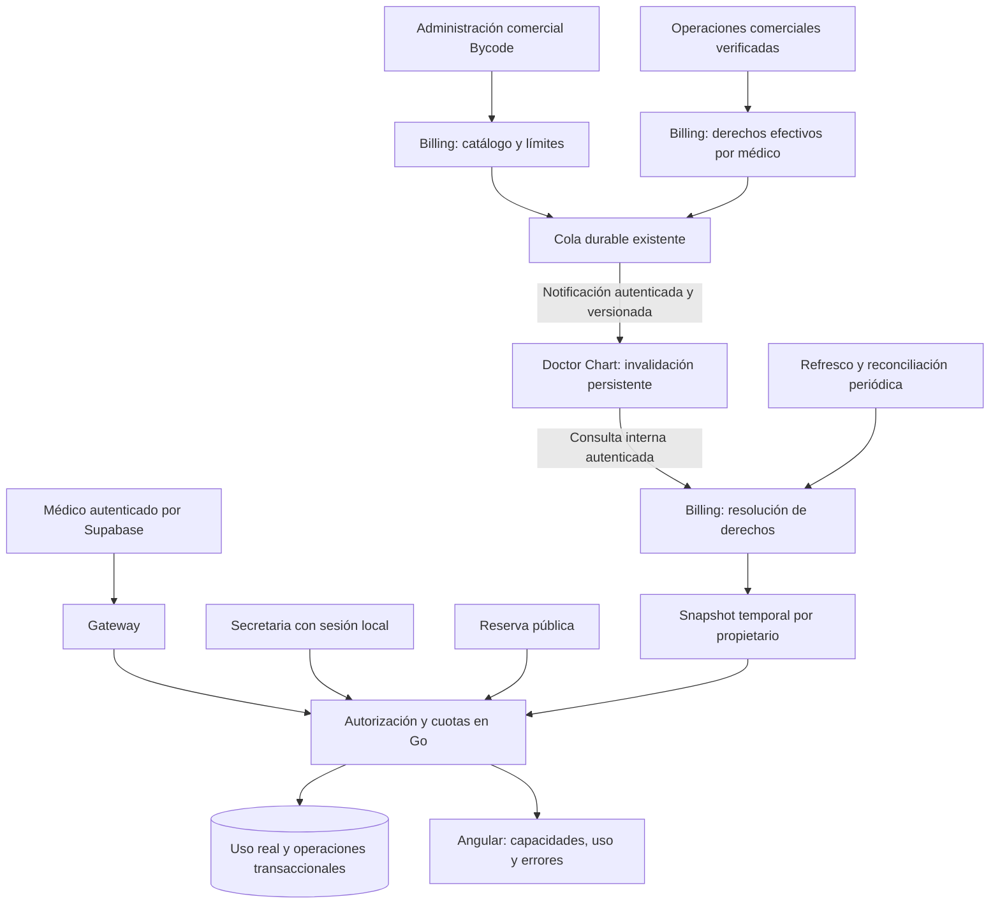

> **ANTECEDENTE HISTÓRICO — NO EJECUTAR COMO INSTRUCCIONES.** Este informe no es una decisión vigente ni acredita implementación o pruebas. Pacientes e historias pertenecen al médico; no agregar `patients.clinic_id`, no separar clínica ni exigir consultorio. Staff tendrá auth local Doctor Chart; Billing define límites. Ruta pública confirmada: `/appointments`, sin alias ni redirecciones; segmentos de médico/consultorio pendientes. Todo modelo, cuota, ruta o plan aquí descrito es antecedente o propuesta, sujeto a [decisiones vigentes](../02_DECISIONS.md). El trabajo anterior se descartó intencionalmente: no recuperarlo ni reconstruirlo.

**Billing seguirá siendo la única fuente de planes, funcionalidades y cuotas.** Doctor Chart conservará una copia verificable y temporal de los derechos efectivos de cada médico y comprobará el uso real de sus recursos en PostgreSQL.

La integración existente es aprovechable, pero actualmente distribuye **límites generales por tier**. Debe ampliarse para resolver derechos por propietario, especialmente para secretarias locales, reservas públicas y cambios de plan.

No modifiqué código ni ejecuté pruebas o migraciones. Los valores encontrados en el código se describen como hechos actuales; **no se proponen cantidades nuevas para los planes**.

## 1. Estado verificado de la integración actual

### Planes y límites en Bycode/Billing

El backend comercial disponible es `bycode-backend-go`, cuyo módulo Go se denomina `billing-service-go`.

| Elemento | Implementación comprobada |
|---|---|
| Planes comercializables | Tabla `billing_plans`: módulo, tier, período, precio, moneda y publicación. |
| Cuotas y funcionalidades | Tabla `module_tier_limits`, con un objeto `limits jsonb` por módulo/tier. |
| Consulta de límites | `GET /api/billing/limits` y `GET /api/billing/limits/{module}`. |
| Administración | `PUT /api/billing/limits/{module}/{tier}`, protegido como operación administrativa. |
| Doctor Chart | Actualmente solo admite `max_patients` y `max_records_per_patient`. |
| Tipos | Cuotas enteras; `-1` significa ilimitado. Existe soporte de booleanos para una funcionalidad de Pointly. |
| Restricciones nuevas | Se rechazan las claves que no estén registradas expresamente. |

Esto está implementado en [el esquema comercial](C:/Users/gcast/Documents/GitHub/bycode-backend-go/db/schema.sql:160), [`limitKeys`, `ModuleLimits` y `PutLimit`](C:/Users/gcast/Documents/GitHub/bycode-backend-go/internal/billing/catalog.go:105), y [las rutas HTTP](C:/Users/gcast/Documents/GitHub/bycode-backend-go/internal/billing/http.go:42).

Los límites no dependen actualmente del período comprado: se configuran por módulo y tier.

### Cómo se comunica un cambio

`PutLimit` guarda los límites y encola una notificación **dentro de la misma transacción**.

El mecanismo es:

1. Actualización de `module_tier_limits`.
2. Inserción en `billing_webhook_jobs`, con topic `doctorchart`.
3. Un worker envía un `POST` al callback configurado.
4. Doctor Chart consulta nuevamente el catálogo de límites.
5. Solo reconoce éxito del callback si la recarga fue válida.

La cola tiene:

- Estado persistente.
- Claim mediante `FOR UPDATE SKIP LOCKED`.
- Lease recuperable.
- Reintentos con espera creciente.
- Paso a revisión después de fallos repetidos.

Referencias: [`notifyLimits`](C:/Users/gcast/Documents/GitHub/bycode-backend-go/internal/billing/workers.go:16), [`claimPaymentJob`, `finishPaymentJob` y `handlePaymentJob`](C:/Users/gcast/Documents/GitHub/bycode-backend-go/internal/billing/payment_jobs.go:105).

Aunque el archivo se denomine `payment_jobs.go`, también procesa estas notificaciones de límites. No hace falta crear otro sistema de colas para esa finalidad.

### Autenticación de las notificaciones

El callback utiliza `X-Internal-Secret`, comparado en tiempo constante por Doctor Chart.

No utiliza el JWT del médico ni el secreto del Gateway como sustituto. Billing toma esa credencial de su configuración comercial; el campo interno se llama `PointlySecret`, pero actualmente también se usa para Doctor Chart.

El callback existe en:

- `/internal/webhooks/billing/limits-updated`.
- `/api/doctorchart/internal/webhooks/billing/limits-updated`.

La consulta posterior al catálogo es actualmente un endpoint público y no lleva credencial interna. Referencias: [callback de Doctor Chart](C:/Users/gcast/Documents/GitHub/doctorchart-backend-go/internal/api/server.go:54) y [envío desde Billing](C:/Users/gcast/Documents/GitHub/bycode-backend-go/internal/billing/payment_jobs.go:149).

### Duplicados, desorden y pérdida

| Situación | Comportamiento actual |
|---|---|
| Callback duplicado | Vuelve a consultar el estado actual; no incrementa cuotas ni aplica un crédito. |
| Callbacks desordenados | No contienen valores históricos que sobrescriban directamente el catálogo: ordenan una recarga. |
| Callback perdido | El refresco periódico de Doctor Chart puede recuperar el cambio. |
| Error del callback | Billing reintenta; Doctor Chart conserva su último snapshot válido. |
| Fallos prolongados | La notificación puede pasar a revisión; el refresco periódico sigue siendo un respaldo. |

**No existe una versión comercial en el callback actual.** La clave de deduplicación de la cola tampoco constituye una revisión del catálogo o de la suscripción.

### Caché en Doctor Chart

[`internal/billing/rules.go`](C:/Users/gcast/Documents/GitHub/doctorchart-backend-go/internal/billing/rules.go:26) implementa:

- Refresco cada minuto.
- Vigencia máxima de diez minutos.
- Publicación atómica del snapshot en memoria.
- Conservación del último estado válido ante errores.
- Recuperación HTTP antes de una operación cuando la caché deja de estar disponible.
- Refresco independiente en cada réplica.

Hay una distinción relevante: **el catálogo de límites y el beneficio del usuario llegan por caminos diferentes**.

El Gateway obtiene tier y vencimiento desde los claims Supabase. Doctor Chart combina ese beneficio con su catálogo de límites. Véase [`moduleBenefit` y `benefitForRoute`](C:/Users/gcast/Documents/GitHub/api-ai-gateway-go/auth.go:95).

### Límites actuales de pacientes

La implementación ya evita carreras de cuota:

- `CreatePatient` bloquea el workspace del propietario.
- Cuenta `patients WHERE user_id = propietario`.
- Comprueba el límite.
- Inserta dentro de la misma transacción.

Por tanto, el límite actual es **global por médico**, no por consultorio.

`CreateEncounter` bloquea al paciente y cuenta sus filas en `clinical_encounters`. `max_records_per_patient` limita consultas clínicas, no todos los tipos de documentos.

Referencias: [`CreatePatient`](C:/Users/gcast/Documents/GitHub/doctorchart-backend-go/internal/clinical/patient.go:375) y [`CreateEncounter`](C:/Users/gcast/Documents/GitHub/doctorchart-backend-go/internal/clinical/encounter.go:172).

### Incompatibilidades que deben corregirse

1. **Doctor Chart rechaza claves nuevas.** Añadir `max_clinics` al catálogo que consume hoy provocaría rechazo de la recarga.
2. **Existen valores comerciales codificados en Go:** defaults, fallbacks y cuotas específicas de `FREE_TRIAL`.
3. **`ENTERPRISE` se transforma localmente en `UNLIMITED`.**
4. **El `PUT` actual reemplaza el mapa completo**, incluso admite mapas vacíos. Un administrador antiguo podría eliminar claves nuevas.
5. **No hay una proyección versionada de derechos efectivos por médico.**
6. Los flujos inspeccionados de pago y concesiones actualizan y verifican metadata Supabase, pero no publican actualmente ese nuevo contrato de derechos hacia Doctor Chart.
7. No debe asumirse un flujo completo de reducción programada de plan: las concesiones actuales incluso rechazan determinados cambios a tiers inferiores mientras hay cobertura vigente.

Los puntos de integración relevantes son [`completeGrant`](C:/Users/gcast/Documents/GitHub/bycode-backend-go/internal/billing/admin_grants.go:295), [`completeCredit`](C:/Users/gcast/Documents/GitHub/bycode-backend-go/internal/billing/payment_credit.go:411) y [`Supabase.Coverage`](C:/Users/gcast/Documents/GitHub/bycode-backend-go/internal/billing/integrations.go:93).

### Angular

Bycode ya tiene una pantalla administrativa de límites. Su configuración de Doctor Chart contiene únicamente las dos claves actuales. Además, al desmarcar “ilimitado”, introduce valores sugeridos según tier; ese comportamiento debe revisarse para no inventar cantidades nuevas. Véanse [los campos existentes](C:/Users/gcast/Documents/GitHub/bycode-frontend/src/app/core/models/billing-limits.model.ts:52) y [`toggleUnlimited`](C:/Users/gcast/Documents/GitHub/bycode-frontend/src/app/pages/admin/module-tier-limits/module-tier-limits.component.ts:560).

En Doctor Chart no encontré un consumo actual de cuotas para mostrar uso y capacidad disponible. Su estado comercial visible se apoya principalmente en los claims de sesión.

## 2. Comunicación propuesta entre servicios

Recomiendo mantener el patrón existente: **notificación durable más consulta del estado vigente**.



Doctor Chart no guarda una tabla propia de planes con equivalencias `BASIC → cantidades`. Guarda un snapshot recibido de Billing, su versión y vigencia, y calcula su uso local.

No se introduce un broker nuevo ni se modifica la arquitectura de pagos.

## 3. Contrato tipado y versionable

### Tres conceptos separados

1. **Catálogo comercial:** qué concede cada configuración comercial.
2. **Derecho efectivo:** qué tiene vigente un médico determinado.
3. **Uso:** cuántos recursos consume en Doctor Chart.

Billing resuelve los dos primeros. Doctor Chart determina el tercero.

### Contrato inicial propuesto

La siguiente es una definición conceptual, no una implementación:

```ts
type Quota =
  | { mode: 'LIMITED'; maximum: number }
  | { mode: 'UNLIMITED' };

interface DoctorChartCapabilitiesV1 {
  schemaVersion: 1;
  ownerUserId: string;

  catalogRevision: string;
  entitlementRevision: string;

  coverage: {
    status: 'ACTIVE' | 'EXPIRED' | 'INACTIVE' | 'REVIEW_REQUIRED';
    effectiveFrom: string | null;
    expiresAt: string | null;
  };

  features: {
    appointmentManagement: boolean;
    onlineBooking: boolean;
  };

  quotas: {
    clinics: Quota;
    staffRelations: Quota;
    patients: Quota;
    encountersPerPatient: Quota;
  };

  evaluatedAt: string;
  refreshAfter: string;
  freshUntil: string;
}
```

Las revisiones se transportan como cadenas decimales para evitar pérdida de precisión en JavaScript; se comparan numéricamente.

Propiedades del contrato:

- No contiene cantidades nuevas propuestas.
- Un límite ausente no significa ilimitado.
- Una configuración incompleta produce un error explícito.
- No se deducen capacidades del nombre del tier.
- `UNLIMITED` no significa acceso sin vencimiento.
- Los permisos de secretaria no forman parte de la suscripción.
- Un derecho comercial nunca habilita un módulo suspendido por código.
- La vigencia de caché no extiende el vencimiento de cobertura.

Los campos fijos y su significado sí deben estar tipados en Go y Angular. **Lo que no debe codificarse allí son las cantidades o asignaciones por plan.**

### Cambios mínimos en Billing

Propongo:

- Extender su catálogo actual con las nuevas capacidades registradas.
- Versionar el catálogo.
- Mantener una proyección versionada del beneficio confirmado de cada médico.
- Exponer una consulta interna autenticada que resuelva el contrato completo.
- Publicar invalidaciones cuando cambie el catálogo o un derecho confirmado.

La proyección se integra en los procesos actuales de concesión y acreditación; no sustituye sus registros ni repite escrituras remotas a Supabase.

Una operación comercial `writing` o `ambiguous` no debe publicarse como beneficio confirmado. La actualización de la proyección y su notificación deben acompañar la finalización local verificada, respetando el guard existente por usuario.

### Compatibilidad

No se deben añadir claves directamente a la respuesta que consume el `Rules.fetch` actual.

Recomiendo:

- Conservar lecturas legacy.
- Introducir el contrato tipado mediante una operación versionada.
- Actualizar consumidores antes de retirar fallbacks.
- Impedir que escrituras administrativas antiguas borren las capacidades nuevas.
- Añadir control de revisión al editor comercial para detectar ediciones concurrentes.

`FREE_TRIAL` debe pasar a una configuración administrada por Billing, conservando inicialmente sus cuotas existentes. La equivalencia de `ENTERPRISE`, si se mantiene, también debe resolverse allí.

Las nuevas cantidades deben configurarse y aprobarse en Bycode antes de habilitar las funcionalidades dependientes.

## 4. Matriz de funcionalidades y consumo

La siguiente política es una **recomendación para aprobar**.

| Recurso/operación | Derecho | Cómo se mide |
|---|---|---|
| Crear consultorio | Cuota `clinics` | Consultorios no archivados del propietario. |
| Reactivar uno archivado | Cuota `clinics` | Vuelve a consumir cupo. |
| Activar/inactivar temporalmente | Sin liberar cupo | Ambos estados mantienen el recurso contratado. |
| Conservar sede archivada | Sin consumo de cupo de consultorio | Solo conservación y acceso histórico. |
| Invitar secretaria | Cuota `staffRelations` | Reserva cupo para la relación médico–secretaria pendiente. |
| Secretaria activa en varias sedes | Misma cuota | Una relación consume una unidad para ese médico. |
| Misma cuenta para otro médico | Cuota del otro médico | Consume una relación independiente. |
| Crear paciente | Cuota `patients` | Todos los registros del médico, manteniendo el criterio actual. |
| Crear consulta clínica | `encountersPerPatient` | Consultas de ese registro independiente. |
| Crear turno manual | `appointmentManagement` | Agenda y sede autorizadas. |
| Reservar públicamente | Ambas funcionalidades de agenda y online | Además de disponibilidad y controles de publicación. |
| Gestionar compromisos existentes | Política de continuidad | No desaparece por reducción de capacidad. |
| Límite por volumen de reservas | Futuro | No se activa hasta definir métrica, período y tratamiento de cancelaciones. |

### Consultorios

Recomiendo que **activos e inactivos consuman cupo**. De lo contrario, se podría eludir el límite alternando estados.

Archivar libera cupo de consultorio, pero:

- No elimina pacientes.
- No libera automáticamente la cuota global de pacientes.
- No permite nuevas actuaciones ordinarias.
- No cancela reservas.
- No equivale a ocultar o borrar información.

Reabrir exige comprobar capacidad.

### Secretarias

Se cuentan relaciones, no cuentas globales ni sesiones.

- Pendiente y activa consumen.
- Reenviar la misma invitación no consume otra unidad.
- Revocación libera el cupo de esa relación.
- Una invitación vencida sin aceptación puede liberar su reserva de cupo mediante una transición controlada.
- Un bloqueo temporal de login no libera cuota comercial.
- Agregar otra sede a la misma relación no consume otra secretaria.

### Pacientes y consultas

Se conserva el alcance actual:

- Un médico tiene una cuota global de registros de pacientes.
- Dos registros independientes con el mismo documento cuentan como dos.
- Las consultas se cuentan por `patient_id`.
- Reservar no consume cupo clínico porque no crea paciente ni consulta.
- Superar una cuota no bloquea por sí solo lectura o edición de registros existentes.
- No se recomienda borrar información clínica para liberar cupo.

## 5. Estrategia transaccional y concurrencia

### Estado local mínimo

Propongo una fila de control por propietario en Doctor Chart, por ejemplo `owner_commercial_state`, con:

- Snapshot comercial aceptado.
- Revisiones.
- Vigencia.
- Estado de invalidación.
- Información necesaria para selección operativa.

Y un estado de catálogo que permita conocer la revisión mínima requerida sin actualizar masivamente todas las cuentas ante cada cambio general.

Son proyecciones y controles locales, no un segundo sistema comercial.

### Alta de un recurso

El procedimiento recomendado es:

1. Resolver actor, propietario y recurso.
2. Obtener derechos vigentes si hace falta, **antes de tomar bloqueos de negocio**.
3. Abrir transacción.
4. Bloquear la fila comercial del propietario.
5. Releer snapshot, revisiones, vigencia y estado de selección.
6. Validar capacidad y autorización.
7. Contar consumo real.
8. Comprobar `uso + incremento <= límite`.
9. Crear el recurso y su auditoría.
10. Confirmar.

Si dos solicitudes compiten por el último consultorio o la última relación de secretaria, solo una podrá consumirlo.

Todas las operaciones que aumenten consumo deben seguir el protocolo: creación, reapertura, reactivación y aceptación cuando corresponda. La aceptación de una invitación cuyo cupo ya estaba reservado no vuelve a consumirlo.

Los bloqueos de filas permiten serializar estas decisiones entre réplicas; un mutex de proceso no alcanza. [Bloqueos de PostgreSQL](https://www.postgresql.org/docs/17/explicit-locking.html).

### Conservar el comportamiento existente

Hoy la cuota de pacientes utiliza el workspace y las consultas bloquean al paciente. La introducción del estado comercial debe respetar un orden de adquisición uniforme.

No se deben añadir consultas HTTP dentro de las transacciones. Ya existe una regresión que comprueba que recuperar Billing no mantiene conexiones o bloqueos clínicos.

Tampoco basta con un conteo dentro de cualquier transacción: en `READ COMMITTED`, las operaciones concurrentes necesitan un punto común de serialización. [Aislamiento en PostgreSQL](https://www.postgresql.org/docs/17/transaction-iso.html).

### Cambio comercial concurrente

La aplicación local de un nuevo snapshot utiliza la misma fila comercial.

- Si una creación termina antes de aplicar la reducción, su recurso se conserva.
- Si la reducción se aplica primero, la creación evalúa el límite nuevo.
- Una respuesta HTTP antigua de Billing no reemplaza una revisión nueva.
- Al llegar el vencimiento se comprueba la fecha, aunque ningún evento lo anuncie.

**No existe atomicidad instantánea entre la base de Billing y la de Doctor Chart.** La garantía local se aplica al snapshot aceptado, con una ventana de propagación limitada por su vigencia. Una garantía global sin esa ventana exigiría otro protocolo de autorización por operación.

### Errores para Angular

Propondría errores distinguibles:

| Código | Significado |
|---|---|
| `CLINIC_LIMIT_REACHED` | No queda cupo de consultorios. |
| `STAFF_LIMIT_REACHED` | No queda cupo de relaciones. |
| `PATIENT_LIMIT_REACHED` | Se alcanzó la cuota actual. |
| `ENCOUNTER_LIMIT_REACHED` | Se alcanzó la cuota del paciente. |
| `FEATURE_NOT_INCLUDED` | La funcionalidad no está concedida. |
| `COMMERCIAL_SELECTION_REQUIRED` | Hay recursos retenidos que exceden el nuevo plan. |
| `ENTITLEMENTS_UNAVAILABLE` | No pueden comprobarse derechos vigentes. |
| `CAPABILITIES_NOT_CONFIGURED` | Configuración comercial incompleta o incompatible. |

La respuesta puede incluir uso, límite y revisión. Angular los muestra, pero esos valores nunca se aceptan de vuelta como autorización.

## 6. Cambios de plan, vencimiento y reconciliación

### Mejora de plan

- Se acepta una revisión nueva confirmada.
- Aumenta la capacidad disponible.
- No se reactivan automáticamente sedes archivadas ni relaciones revocadas.
- La interfaz refresca derechos y permite nuevas operaciones.

### Reducción con exceso de recursos

Hay que separar:

1. Recursos conservados.
2. Capacidad de crear más.
3. Selección de recursos operativos.

Recomiendo:

- Conservar todos los recursos y sus datos.
- Bloquear nuevas altas mientras corresponda por cuota.
- Permitir al médico seleccionar hasta el nuevo límite de recursos operativos.
- Mantener los demás en conservación/histórico y gestión acotada de compromisos.
- No transformar automáticamente una reducción en archivo, revocación o eliminación.

La selección comercial es distinta del estado voluntario activo/inactivo/archivado.

Mientras falte una selección necesaria, se permiten lectura, resolución y continuidad administrativa; las operaciones ordinarias que requieran capacidad quedan explícitamente restringidas. El servidor no elige arbitrariamente qué sede conserva actividad.

### Exceso de secretarias

- No se elimina ninguna cuenta local.
- El médico elige qué relaciones mantienen actividad ordinaria.
- Las restantes quedan suspendidas comercialmente para ese propietario.
- Sus accesos con otros médicos no cambian.
- Una futura mejora no revoca decisiones de seguridad anteriores.

### Pérdida de turnos online

Se dejan de ofrecer nuevas reservas públicas.

Las reservas confirmadas siguen existiendo y pueden gestionarse. El médico puede mantener reservas manuales si `appointmentManagement` sigue habilitado y la sede resulta operativa.

### Vencimiento

- La fecha limita la operación ordinaria sin depender de un webhook.
- Se preservan historia y compromisos.
- Se mantiene una vía administrativa acotada de consulta, cancelación y registro de llegada/ausencia.
- No se amplía automáticamente el acceso clínico de secretarias.

La política comercial no sustituye las obligaciones de custodia.

### Billing inaccesible

Distinguir:

| Estado | Tratamiento |
|---|---|
| Snapshot válido y vigente | Se utiliza hasta su límite de vigencia. |
| Refresco fallido | Se conserva la copia; no se extiende su vigencia unilateralmente. |
| Snapshot vencido o inexistente | Se bloquean nuevas operaciones que requieren derecho comercial. |
| Lectura histórica y continuidad permitida | Se aplican sus permisos y políticas específicos. |
| Estado comercial indeterminado | No se convierte en plan gratuito, BASIC o ilimitado. |

Hay un detalle operativo importante: actualmente la readiness de Doctor Chart depende de disponer de reglas comerciales vigentes. Si una infraestructura retira todas las instancias por esa condición, las lecturas de continuidad tampoco llegarían a sus handlers.

La arquitectura debe distinguir indisponibilidad total de **servicio comercial degradado**, con pruebas del comportamiento de readiness. No basta con autorizar lecturas en el código de negocio.

### Webhooks y consulta de respaldo

Extendería la notificación con un sobre versionado:

- Identificador del evento.
- Tipo `CATALOG_CHANGED` o `OWNER_ENTITLEMENT_CHANGED`.
- Propietario cuando corresponda.
- Revisión.
- Versión de contrato.

El evento invalida o eleva la revisión mínima requerida. **No incrementa ni resta derechos mediante deltas.** Doctor Chart vuelve a consultar el estado completo.

La recepción persiste la invalidación antes de reconocerla. Así, un reinicio no pierde el cambio.

Se conserva el callback antiguo para compatibilidad y se reutiliza la cola durable. Las nuevas operaciones internas se registran expresamente también en el Gateway.

La reconciliación periódica y bajo demanda cubre:

- Eventos perdidos.
- Entregas agotadas.
- Reinicios.
- Propietarios que no estaban cargados.
- Proyecciones desactualizadas.

Los procesos de consulta no deben asignar una revisión nueva a una observación antigua. Billing debe vincular las revisiones a cambios confirmados y coordinar su reconciliación con los guards existentes.

## 7. Suscripciones y secretarias locales

La autorización administrativa requiere simultáneamente:

`sesión local válida + relación vigente + sede autorizada + capacidad administrativa + política comercial del propietario`

No se usa:

- Una suscripción de la secretaria.
- El plan de otro empleador.
- El último médico seleccionado globalmente.
- Un propietario suministrado sin validación por Angular.
- Un rol médico fabricado para reutilizar los handlers clínicos.

Una cuenta que trabaje para los médicos A y B tiene dos relaciones. Puede estar habilitada para A y suspendida comercialmente para B.

El login local sigue siendo independiente de Billing. Tener una sesión no demuestra derecho a operar una sede.

### Autenticación médica

Se conserva Supabase y el Gateway.

Sí debe separarse la verificación de identidad de la evaluación comercial, hoy mezcladas en el middleware de Doctor Chart. Un claim anterior no debe imponerse sobre un derecho efectivo más reciente.

La transición debe resolver también el caso inverso: el médico acaba de mejorar o renovar, pero su token todavía contiene el beneficio anterior. La consulta de capacidades necesita poder ejecutarse con identidad válida sin exigir primero ese beneficio antiguo.

Esto no implica cambiar credenciales, emisor JWT o mecanismo de login.

## 8. Riesgos principales

| Riesgo | Medida |
|---|---|
| Nuevas claves rompen clientes actuales | Contrato versionado y despliegue compatible de consumidores. |
| Un editor antiguo borra claves nuevas | Proteger escrituras legacy y exigir configuración completa/revisión en la nueva interfaz. |
| Snapshot viejo reemplaza uno nuevo | Revisiones monotónicas y comparación antes de persistir. |
| Réplicas deciden con versiones distintas | Snapshot y barreras de revisión compartidos en PostgreSQL. |
| Duplicados consumen recursos dos veces | Idempotencia de comandos, eventos y relaciones únicas. |
| Cuota de secretaria aplicada globalmente | Contar por relación con propietario. |
| Recuperar Billing mantiene bloqueos | HTTP fuera de transacciones de negocio. |
| Reducción borra o cancela | Conservación explícita; selección separada del ciclo de vida. |
| Alias o defaults conceden capacidad indebida | Resolución completa en Billing, sin fallback comercial local. |
| Estado remoto ambiguo se publica como activo | Publicar solo resultados verificados; conservar los mecanismos de revisión existentes. |
| Caché promete revocación inmediata | Vigencia y ventana de propagación explícitas. |
| Aplicar nuevas cuotas reactiva funciones suspendidas | Derecho comercial combinado con disponibilidad técnica y permisos. |

Mantendría las excepciones administrativas actuales separadas y auditadas. Nunca se transmiten a una secretaria local por trabajar para un médico.

## 9. Pruebas necesarias

Ya existen bases útiles: [pruebas de notificación y reintentos](C:/Users/gcast/Documents/GitHub/bycode-backend-go/internal/billing/limit_notifications_test.go:15), [validación de snapshots](C:/Users/gcast/Documents/GitHub/doctorchart-backend-go/internal/billing/rules_test.go:12), [confirmación del callback](C:/Users/gcast/Documents/GitHub/doctorchart-backend-go/internal/api/billing_reload_test.go:14) y [cuotas concurrentes](C:/Users/gcast/Documents/GitHub/doctorchart-backend-go/internal/clinical/integrity_integration_test.go:158).

Añadiría:

| Grupo | Casos |
|---|---|
| Contrato | Cuota cero, ilimitada, ausente, inválida; versión no soportada; configuración incompleta. |
| Compatibilidad | Consumidor antiguo, editor antiguo y catálogo ampliado sin pérdida de claves. |
| Concurrencia | Dos altas con un cupo; reapertura contra creación; invitación contra activación/vencimiento. |
| Cambios de plan | Mejora o reducción durante una operación; actualización que espera un bloqueo; token médico anterior. |
| Eventos | Duplicados, desordenados, perdidos, reintentos y reinicio después de ACK. |
| Reconciliación | Catálogo nuevo, beneficio nuevo y respuesta antigua tardía. |
| Fallos | Billing caído con snapshot vigente, vencido o inexistente; recuperación sin extender derechos indebidamente. |
| Preservación | Reducción sin borrar pacientes, archivos, usuarios ni reservas. |
| Secretarias | Misma cuenta con dos médicos y derechos distintos. |
| Seguridad | Cuotas o propietario manipulados en requests; credenciales internas inválidas. |
| Angular | Uso actualizado, errores claros y contexto separado por médico/sede. |
| Operación | Readiness y continuidad durante degradación comercial. |
| Instalación | Migración conservadora y creación vacía con el mismo catálogo final. |

Los límites futuros por período requieren pruebas propias de ventana temporal, cancelaciones y reprogramaciones. No los implementaría mediante un contador mensual ambiguo.

## 10. Impacto sobre las fases y decisiones por aprobar

Este bloque comercial debe incorporarse **antes de habilitar altas multiconsultorio**.

| Fase | Incorporación |
|---|---|
| Preparación arquitectónica | Aprobar semántica de consumo, selección operativa y contrato. Las cantidades permanecen en Bycode. |
| Evolución de esquema | Versiones comerciales, proyección de derechos e invalidación persistente, respetando los inicializadores actuales. |
| Integración Billing | Contrato efectivo por propietario, publicación confirmada y extensión de la cola existente. |
| Multiconsultorio | Cuota al crear/reabrir y conservación ante reducción. |
| Secretarias locales | Cupo de relaciones e invitaciones, sin suscripción propia. |
| Motor de turnos | Habilitación de agenda y reservas públicas sobre el mismo servicio. |
| Frontend | Editor comercial de Bycode actualizado; Doctor Chart muestra derechos efectivos, uso y restricciones. |
| Validación integral | Pruebas entre servicios, caída de Billing, reducción concurrente y recuperación. |

La interfaz de Doctor Chart debería recibir una respuesta propia de **capacidades y uso**, ya autorizada por Go. No necesita reconstruir planes consultando el catálogo público y comparando nombres de tiers.

Quedan para aprobación comercial:

- Las cantidades y funcionalidades de cada plan.
- Que activos e inactivos consuman cupo de consultorio y archivados no.
- Que invitaciones pendientes reserven cupo de secretaria.
- La política de selección y continuidad después de una reducción.
- La vigencia máxima aceptable de los snapshots.
- Si se desea realmente una cuota de volumen de reservas; en ese caso, su métrica y período.

Se mantienen todas las decisiones anteriores: pacientes independientes por consultorio, wizard compartido, médicos mediante Supabase, secretarias con autenticación local y un único motor de turnos.
